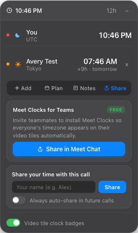
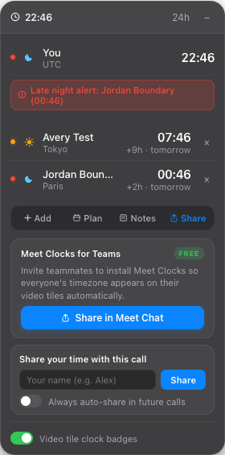
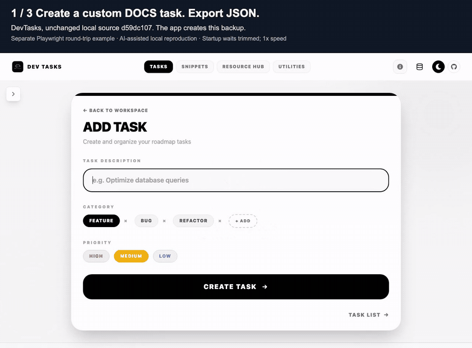
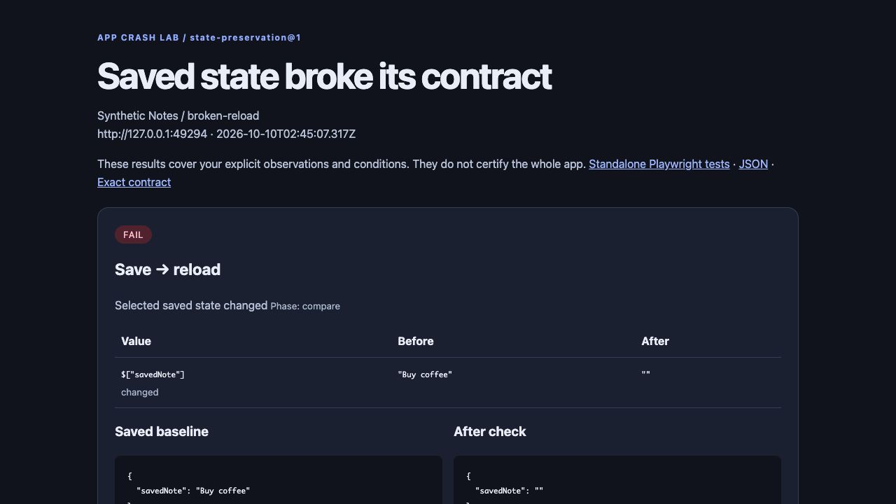
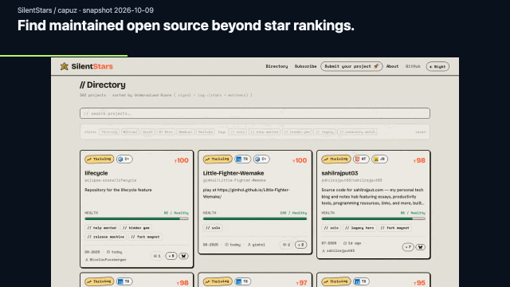
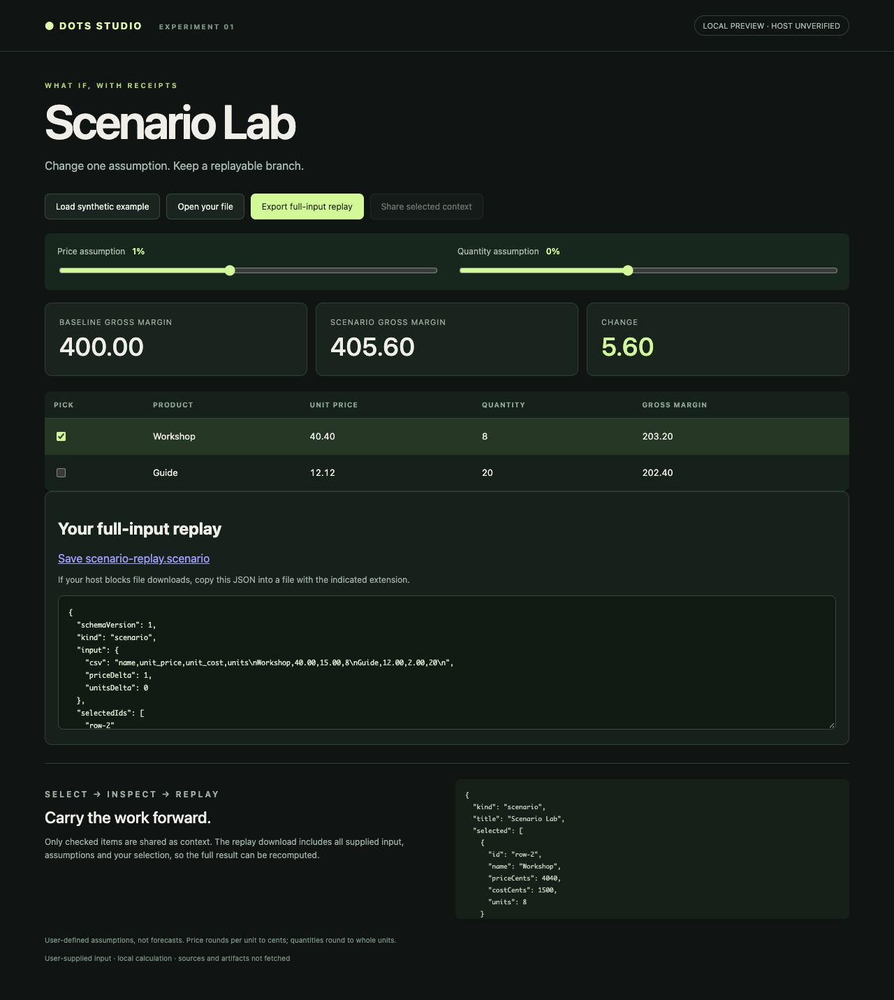

# aichance's developer tools

## Agent Relay Check — inspect AGENTS.md selection, then test receipt

One command shows native startup file selection beside a separate local byte-budget estimate, without a model turn. When you need receipt evidence, a fresh Codex session returns a disposable marker from your instruction file; the expected value never enters the question. Compare before and after a settings or CLI change.

[**Inspect without a model turn**](tools/agent-relay-check/README.md#inspect-your-current-instruction-budget-first) · [**Test marker receipt**](#first-run-keep-the-check-files-outside-your-project) · [**Small v0.1.3 ZIP**](https://aichance.github.io/business-ai-recipes/agent-relay-check-v0.1.3.zip) · [**Measured result and rerun command**](tools/agent-relay-check/examples/MEASUREMENTS.md)

**No local CLI or API key?** [Add the startup-source check to your own GitHub Actions](docs/agent-relay-ci.md). It installs the pinned CLI on a temporary Linux runner and fails when a required file is missing or locally estimated partial. Native path membership and the separate byte estimate are checked; model receipt and compliance remain `NOT_TESTED`.

Before running third-party code, use the [v0.1.3 source map, command side effects and file checksums](docs/agent-relay-source-review.md) to support your own review.

### Public reports

- **Own-project run, v0.1.2:** [YushiYamamoto's report](https://qiita.com/YushiYamamoto/items/5004c1bfbbba9934e953#comment-ff051270778c5e15718e) records `RECEIVED` from their existing synchronized guidance on macOS / Codex0.164.0, zero observed tool calls, and byte-for-byte restoration of the instruction file. This is one developer's public self-report for v0.1.2.
- **A measured finding led to an upstream fix:** our [project-config comparison](docs/agent-relay-project-config.md) exposed a mismatch in Agent Guild's Codex reader. Its maintainer [confirmed the report](https://github.com/oddessentials/agent-guild/issues/189#issuecomment-6378917465) and [merged the fix](https://github.com/oddessentials/agent-guild/pull/313), released as v1.9.1. The maintainer's reported validation used Codex's debug command.

Our four-call demonstration: normal file → base marker received; override added → override marker received; override removed → base marker received again; both removed → neither observed. Fresh sessions, no observed tool calls. This reproduces documented file selection, not a new bug or proof of general instruction compliance.

**Inspection:** Node22+ and installed stable Codex0.163.0 or0.164.0 for the version-specific byte estimate; it requests no model turn. **Separate live marker check:** authenticated Codex CLI0.163.0+ with existing gpt-6.1-sol/MAX access and quota. macOS/Linux or experimental native Windows; no npm dependencies. Scope is startup guidance, with hooks/MCP disabled for the diagnostic and compaction untested.

On native Windows, start with the [PowerShell commands and verification scope](tools/agent-relay-check/README.md#native-windows--powershell). [An external v0.1.2 Windows report](https://github.com/openai/codex/discussions/56176#discussioncomment-19155475) records a completed native inspection on Windows11 / Node24.11.1 / temporary Codex0.163.0, with zero requested model turns and both servers closed. Its live run was `INCONCLUSIVE`; the reporter cites unavailable model auth/quota. This is native-inspection evidence, **not a completed Windows marker receipt** or proof that it improves their workflow.

### Inspect without editing your instructions

After extracting the ZIP, open its `agent-relay-check` directory and run:

```sh
node cli.mjs inspect --project "/absolute/path/to/your project"
```

Native file paths are observations; byte/truncation/skip fields are separate local estimates pinned to the detected stable Codex0.163.0 or0.164.0 loader. A listed file can be partial. Uncertain versions, configuration, files or cleanup remain `INCONCLUSIVE`. No model turn is requested, but Codex initialization can communicate and write its normal local metadata. [Scope and measured controls](tools/agent-relay-check/examples/NATIVE-INSPECTION.md). Inspection does not establish model receipt or compliance; the following separate check uses inference.

[**Measured project-settings example**](docs/agent-relay-project-config.md): the same `project_doc_max_bytes = 0` setting left the effective budget unchanged in one project context and changed native source selection in another. Four inspections requested zero model turns; the example keeps the unchanged result and the configuration-layer evidence.

**Moving global rules with dotfiles?** [Four measured global-file/symlink controls](docs/agent-relay-global-guidance.md) show a known outside-project source count falling from1 to0 for a broken link. A target-content update leaves that count unchanged; inspection is separate from marker receipt.

**Each file fits, but the child is still partial:** [Three reproducible cumulative-budget controls](docs/agent-relay-cumulative-budget.md) compare a pinned per-file checker with native startup paths and Relay's separate local estimate. Root 24,000 B + child 18,000 B pass the per-file check; startup in the child leaves 8,768 B of the shared 32,768 B budget for it. Zero model turns; operator measurements, not external adoption.

### First run: keep the check files outside your project

After extracting the ZIP, open its `agent-relay-check` directory. The following works from the cloned `tools/agent-relay-check` directory too. Create a new temporary workspace and confirm it is **outside the project you intend to check**; don't put challenge or result files inside that project.

```sh
RELAY_WORK="$(mktemp -d "${TMPDIR:-/tmp}/agent-relay.XXXXXX")"
node cli.mjs prepare --keys project_probe --out "$RELAY_WORK/before"
```

Append the diagnostic block from `$RELAY_WORK/before/instruction.md` to the existing instruction file you want to check. Do not replace the original instructions or paste `challenge.json` into the agent. Keep this shell open so `RELAY_WORK` still points to the same directory. Replace the quoted example below with your actual startup directory (the child directory when checking its guidance):

```sh
node cli.mjs run \
  --project "/absolute/path/to/your project" \
  --challenge "$RELAY_WORK/before/challenge.json" \
  --out "$RELAY_WORK/result-before" \
  --live
```

This makes **one model call**. A directory name containing spaces must stay quoted. Each output directory must be new; a rejected path or preflight is not a failed receipt. [Read the three possible results](tools/agent-relay-check/README.md#read-the-result).

After a settings or CLI change, keep the same shell and marker name. Prepare a fresh block, **replace only the previous diagnostic block** in the same instruction file, and run once more:

```sh
node cli.mjs prepare --keys project_probe --out "$RELAY_WORK/after"
# Replace the old block with the one in "$RELAY_WORK/after/instruction.md", then:
node cli.mjs run \
  --project "/absolute/path/to/your project" \
  --challenge "$RELAY_WORK/after/challenge.json" \
  --out "$RELAY_WORK/result-after" \
  --live
node cli.mjs compare \
  --before "$RELAY_WORK/result-before/report.json" \
  --after "$RELAY_WORK/result-after/report.json"
```

Keep the startup directory the same and record what changed. The second live check makes one additional model call; preparation and comparison are offline. Remove only the diagnostic block when finished. For another comparison, start a new temporary workspace so none of the output directories already exists.

To start without editing your own instructions, use `node examples/override.mjs --out "$RELAY_WORK/demo" --live`. This alternative requires **Git** as well as the prerequisites above and makes **four model calls** in a disposable project. The v0.1.0 download is unchanged; these workspace examples clarify its original instructions.

---

## App Crash Lab

[日本語の体験・導入手順](tools/app-crash-lab/README.md#japanese-setup)

**Your app says “Saved.” Does the data survive the next mistake?**

Add one persistence regression to the test setup your app already uses. Choose Playwright for browser behavior, or explicitly choose Vitest, Node tests or a registered JavaScript selfcheck for the data layer. Start with a measured example and keep the adapted test in your release checks. These paths need no App Crash Lab runtime or JSON contract.

[**Try a real-app before/after**](https://aichance.github.io/business-ai-recipes/pdf-save-lab.html) · [**Copy a native test**](#copy-one-playwright-regression) · [**Ask your coding agent**](https://aichance.github.io/business-ai-recipes/app-crash-lab.html#native-agent)

**A clock appeared in the UI. Reload erased it. The author's fix now keeps it.**

| Original v0.9.2 after reload: new clock absent | Author's v0.9.3 after reload, another UI save and reload: clock retained |
| --- | --- |
|  |  |

The same fallback-aware Playwright spec: **2 PASS/1 FAIL → 3 PASS**. The author
[acknowledged the report and published the fix](https://qiita.com/mamarezza/items/824c0c2fbb75456370da#comment-56d858d800b39f06e1eb).
Our native Chrome check preserves all 108 synthetic address-book entries and
settings through local fallback and a second UI save. [Copy the test and inspect
the complete measurements](tools/app-crash-lab/examples/meet-clocks-native/README.md).
Actual unpacked extension on an empty synthetic Meet host; no live meeting or
Web Store test. The red banner is a time-zone night alert. These are our runs,
separate from the independent author executions below.

**Independently run on four authors’ own apps:** [Sethera](https://qiita.com/cuculhart/items/f020080b2ef1331222d0#comment-79c9c450f3a54f3ba6ac) and [nvim-edu](https://qiita.com/s3onghyun/items/7966ac7e6a534a84f9db#comment-2d25dc275d61b168ee4a) used earlier CLI checks and exported tests; [PDF_Studio’s author](https://qiita.com/yoyoyo2024/items/f4f08276c835cab80b53#comment-23d925ca8772b4a0cb9a) ran the standalone Playwright spec after fixing save cancellation; [OpenPost’s author](https://github.com/azlanabdulla/OpenPost/blob/447408e31e57377a48f52bd28d174e8d57ef2ee0/docs/ISSUE_10_RESPONSE.md) incorporated the supplied Vitest regression and reports 3/3 passing. [Reported environments and scope](#independent-author-reports).

## Copy one Playwright regression

**“Saved” after cancelling, with zero output files.** [Run the real PDF-app check in your browser](https://aichance.github.io/business-ai-recipes/pdf-save-lab.html), then [copy its single Playwright spec](tools/app-crash-lab/examples/pdf-save-native/README.md). Normal save and denied-write fallback preserve both complete pages; cancellation falsely reports success on the affected source. The same document can retry successfully. Synthetic PDF only; browser save APIs are simulated.

| Boundary to check | What the test observes | Start from |
| --- | --- | --- |
| An earlier tab saves an unrelated change | The other tab's committed fields remain intact after the peer save and reload | [LivePage: one native spec](tools/app-crash-lab/examples/livepage-native/README.md) · [NEBULARK: real deployed Flutter UI, no storage mocks](tools/app-crash-lab/examples/nebulark-native/README.md) |
| An older cloud row returns after an offline edit | A real rejected SDK write followed by a successful older read must not erase the newer local record | [Life Tracker: native UI/SDK test and setup](docs/life-tracker-stale-cloud-native.md) |
| A storage write is denied or aborted | Previously saved data stays intact and failure feedback appears; BraiNOTES also checks the app's retry | [Kinetic Curator](tools/app-crash-lab/examples/storage-write-denied-native/README.md) · [BraiNOTES](tools/app-crash-lab/examples/brainotes-native/README.md) |
| A Chrome extension's real sync-storage item exceeds 8 KiB | Complete local fallback survives reload and another UI save, or refusal is explicit; v0.9.2: 2 PASS/1 FAIL → author's v0.9.3: 3 PASS | [Meet Clocks: actual unpacked extension and real Chrome API](tools/app-crash-lab/examples/meet-clocks-native/README.md) |
| Optional result/history storage fails after successful work | The successful output stays usable, instead of being turned into a failed request | [MAL](tools/app-crash-lab/examples/optional-history-native/README.md) · [StatementXL: one file with embedded fixtures](tools/app-crash-lab/examples/optional-result-native/README.md) |
| Destructive action is refused | Existing state stays accurate and no false completion notice is shown | [Stockroom: one Playwright file, real Spring Boot/H2](tools/app-crash-lab/examples/stockroom-native-delete/README.md) · [OpenPost: Vitest, mocked Tauri IPC](tools/app-crash-lab/examples/openpost-native-clear/README.md) |
| A required write fails during a valid JSON restore | The previous saved record remains intact, and any temporary restored state is explained before reload | [Task Packing: native import-completion test](tools/app-crash-lab/examples/task-packing-native/README.md) |

These files target the named apps and measured versions. Follow the selected guide's prerequisites; adapt the UI actions, selectors and storage assertions for another app. Keep the passing controls and observe the failure **after it finishes**. Use the measured versions and limits in each guide to interpret the result.

A related initial-load boundary: [VideoHost component reproduction](docs/video-host-history-native.md) measures a history-only write rejection before HLS starts. It includes two passing controls and preserves the original component source. This is a component fixture, not a complete application run.

For backup export/import, use the [real-file roundtrip path](tools/app-crash-lab/BACKUP.md) instead of substituting a reload check. [Choose among eight persistence boundaries](tools/app-crash-lab/PERSISTENCE-CHECKLIST.md).

## Check the data layer with Node

Already have Node tests or a registered JavaScript selfcheck? [Copy a request for that existing setup](https://aichance.github.io/business-ai-recipes/app-crash-lab.html#node-agent-prompt). Use the supported Node runtime and your app's prerequisites, without adding a test package. The request keeps the real save/load functions, complete saved-state comparisons and a passing control. An incompatible module or harness is a setup gap, not proof of data loss.

[Recovered-draft cleanup: one dependency-free Node test](tools/app-crash-lab/examples/draft-recovery-native/README.md) catches an older restored copy deleting another context’s newer complete recovery stash. This is an original-module `vm` check with two passing controls, not a full editor or server test.

[**Same preservation boundary in a dependency-free Node workflow**](tools/app-crash-lab/examples/misaneco-native/README.md): the diagnosis app’s existing 76,788 checks pass, while an earlier state’s industry change clears two newer task selections. One Node file and an optional real-browser replay both produce two passing controls and one preservation failure on the pinned original source.

These Node results do not establish actual browser reload, peer-tab or real-file backup preservation. Choose the corresponding browser or backup path when that is the behavior you need to check.

## Check your own app

Already have a test setup? [Choose Playwright for browser behavior, or explicitly choose Vitest, Node tests or a registered JavaScript selfcheck for the data layer](https://aichance.github.io/business-ai-recipes/app-crash-lab.html#native-agent). Use your existing compatible harness, runtime and app prerequisites, without installing the App Crash Lab runner or skill. Data-layer results do not establish browser reload, peer-tab or backup behavior.

Use a disposable **local copy of your app**, with **Node 22+ and npm**.

1. Open that app's project in your existing coding agent.
2. [**Copy the setup prompt**](https://aichance.github.io/business-ai-recipes/app-crash-lab.html#agent). It asks the agent to inspect your actual save flow, write `my-app.json` and run the pinned checks. For JSON export/import, choose the [**backup setup prompt**](https://aichance.github.io/business-ai-recipes/app-crash-lab.html#backup-agent) instead; it explicitly runs the real-file roundtrip.
3. Review the contract, report and generated Playwright tests. If only reload applies, select it explicitly and report that rejected updates were not tested.

The runner makes no LLM calls; optional agent setup uses your existing agent. Prefer manual setup? [Create, adapt and run a config](tools/app-crash-lab/README.md) · [Contract format](tools/app-crash-lab/CONTRACT.md). [日本語の導入手順](tools/app-crash-lab/README.md#japanese-setup).

**Want Codex to prepare the test for your app?**
With an existing Playwright suite, the skill starts with a matching native
regression; no App Crash Lab runner or JSON is needed for that path. Explicit
runner contracts and real JSON backup roundtrips keep the existing runner path.
With **Node 22.20+**, open **your app project's directory**, review the
[skill source](.agents/skills/app-crash-lab/SKILL.md), and install it with:

```sh
npx --yes skills@1.7.2 add https://github.com/aichance/business-ai-recipes --skill app-crash-lab --agent codex --copy --yes --json
```

Use this only when `.agents/skills/app-crash-lab` does not already exist; keep
and review an existing folder instead of reinstalling. This copies the skill's
four files into that project and adds `skills-lock.json`. The installer also
keeps its own user-level metadata. The installer command was verified on macOS
with Node 24.19.0; the v0.2.2 ZIP is checked separately against all four source files.
[Skills CLI documentation](https://www.skills.sh/docs/cli).

For manual installation or an older Node 22 runtime,
[download the repo-local skill](https://aichance.github.io/business-ai-recipes/app-crash-lab-skill-v0.2.2.zip)
and [checksum](https://aichance.github.io/business-ai-recipes/app-crash-lab-skill-v0.2.2.zip.sha256).
Review it, then place the whole `app-crash-lab` folder in **your app project's**
`.agents/skills/` without overwriting an existing skill. In Codex, ask:

```text
$app-crash-lab Check my app's save workflow with synthetic data.
Inspect the source and explain what you will observe. For a matching boundary
in my existing Playwright suite, adapt and run one native test without another runner.
Otherwise use the pinned runner contract path.
Test one requested boundary; do not replace an explicitly requested backup roundtrip with reload.
Keep the app unchanged and tell me the result and exact rerun command.
```

[Skill source](.agents/skills/app-crash-lab/SKILL.md) · [Installation and scope](https://aichance.github.io/business-ai-recipes/app-crash-lab.html#codex-skill).
Review the proposed observations and actual result. The contract path uses the
existing 0.11.0 runner; installing instructions alone does not test an app.

Already using Vitest for save/load code? For an explicitly requested data-layer
check, the skill can reuse your existing tests. It compares the complete saved
record separately from intentional load-time resets. A store rehydration in
jsdom is not a browser reload, two-tab test or real backup restore; those
requests still require the corresponding browser check.

[**Try App Crash Lab 0.11.0 without cloning**](#try-the-seeded-demo) · [**Release package & checksums**](https://github.com/aichance/business-ai-recipes/releases/tag/app-crash-lab-v0.11.0)

**No install:** [**Would your test catch this?**](https://aichance.github.io/business-ai-recipes/test-the-test.html) Save English, reload a deliberately broken UI, then add a text observation to turn a misleading PASS into a detected failure. This interactive browser example links to the matching CLI checks.

<details>
<summary>More measured app examples, screenshots and maintainer fixes</summary>

[**Pick a regression for your test suite:** eight persistence and save-outcome checks, the missing assertions and copyable tests](tools/app-crash-lab/PERSISTENCE-CHECKLIST.md).

**Minimizing an earlier tab can erase another tab's saved row.** [Copy the single native Playwright test into your existing suite](tools/app-crash-lab/examples/livepage-native/README.md): two controls pass, while the earlier-tab case loses the saved title and row on unmodified LivePage source. It needs no App Crash Lab runtime or JSON contract. The [full original measurement](tools/app-crash-lab/examples/livepage/README.md) and native test both compare the complete page tree and verify the peer's actual persisted commit.

**The same check, ready for another real app:** [Copy one file into StitchWitch's existing Playwright suite](tools/app-crash-lab/examples/stitchwitch-native/README.md). On pinned source, a name-only save from an earlier browser tab rolls a saved 400-cell chart back to white; a separate test catches the committed name reverting on reload. Two scoped controls pass and two regression checks fail. The example includes actual screenshots and complete saved-state assertions.

[**A related delayed-write check:** keep a deleted Perma garden plan deleted](tools/app-crash-lab/examples/perma-native-delete/README.md). One file for the app's existing suite; actual plant drag, committed deletion, both editor/list paths and separate view cleanup.

**The same boundary with IndexedDB:** [a thumbnail-only update rewinds OSW Studio's saved name and checkpoint metadata](tools/app-crash-lab/examples/osw-native/README.md). Two controls pass and the earlier-peer test fails; complete files and checkpoints remain unchanged. Copy one native file, with a small config for the app's locked Playwright dependency.

For a project using plain `playwright` scripts, [copy one file to check ai-dev-readiness drafts](tools/app-crash-lab/examples/readiness-native/README.md): an earlier tab's Back navigation drops another tab's saved answer. The app's existing dependency runs both controls and the regression, without adding a test runner.

**Changing auto-title can undo a system prompt saved in another tab.** [The Naidan native test](tools/app-crash-lab/examples/naidan-native/README.md) runs against a local standalone HTML without an LLM or API key. Two controls pass; the earlier settings tab restores the old prompt, including after the primary tab reloads. The small isolated test ZIP includes the complete measured settings and a locked Playwright dependency.

**A failed save should tell the user.** [Copy the 109-line native write-denial test](tools/app-crash-lab/examples/storage-write-denied-native/README.md) to check both preservation of the previous ledger and visible failure feedback. On pinned Kinetic Curator source, normal saves survive reload; an injected exact-key storage error preserves the old ledger but produces no matching visible notice. The example includes the normal control and marks what to adapt for your app.

For a working IndexedDB recovery path, [BraiNOTES' native abort/retry checks](tools/app-crash-lab/examples/brainotes-native/README.md) both pass: existing ink stays intact during an aborted save, the app reports failure, and its own retry preserves both strokes after reload. The standalone pack checks complete stored data and actual drawn pixels.

**Successful work can be mislabeled as failed when optional history is full.** [Copy the native optional-history test](tools/app-crash-lab/examples/optional-history-native/README.md): pinned MAL keeps a successful translation visible but reports a generic Error after its history write is denied. The test uses local provider stubs, accepts a truthful history-only warning, and keeps genuine provider failures separate. It does not require a real API key or claim the output disappeared.

**“Overwrite succeeded” can leave example jobs in a resume.** [The OpResume replay](tools/app-crash-lab/examples/opresume/README.md) imports its actual 66-byte empty backup, reports success, and keeps three example work entries. Four runnable checks distinguish that restore failure from a passing complete synthetic control.

**A valid empty project is still saved work.** [The Bazkia replay](tools/app-crash-lab/examples/bazkia/README.md) restores its actual JSON successfully, then replaces the named empty project with a sample after reload. Four prepared checks include a passing 3-node/2-link control.

**It exported a backup it could not restore.** In an unchanged local [DevTasks build](tools/app-crash-lab/examples/devtasks/README.md), a synthetic task with a custom `DOCS` category exported successfully, then the same file was rejected in a fresh browser context. The built-in `FEATURE` control restored.

[](https://aichance.github.io/business-ai-recipes/devtasks-backup-roundtrip.mp4)

*[Watch the 21-second MP4](https://aichance.github.io/business-ai-recipes/devtasks-backup-roundtrip.mp4) · [Run the separate Playwright round-trip test](tools/app-crash-lab/examples/devtasks/README.md). This recording uses synthetic records on pinned local source, not the public service. The recording uses the historical separate test; the same real-file checks now run in CLI0.6+. Operator testing is separate from author adoption.*

**Keep the check after fixing the bug.** These two cases now include a maintainer's fix report and our local retest:

| Case | Reported fix | Replay the check |
| --- | --- | --- |
| Repwise 1.1.1: the backup kept a workout that History could not show | [The maintainer reported a 1.2.1 fix](https://github.com/abdulrahmanm-in/repwise/issues/7#issuecomment-6230396169). Our History check now passes; the original backup also restores with all eight stores intact. | [History contract and measured versions](tools/app-crash-lab/examples/repwise/README.md) |
| Kaioken 1.7.1: a numeric-ID record could not open; an object ID aborted import | [The maintainer reported a 1.7.2 fix](https://github.com/rabocse/kaioken-gym-log/issues/32#issuecomment-6211357922). Our unchanged import spec changes from one passing control and two failures to three passes. | [Standalone import spec and CLI control](tools/app-crash-lab/examples/kaioken/README.md) |

These are our retests on pinned local builds. The fix reports do not establish that either maintainer ran App Crash Lab; independent tool-use reports are listed separately above.

</details>

If these checks are useful, [star the repository](https://github.com/aichance/business-ai-recipes) to find them again before your next release. Starring is optional.

## Independent author reports

**Used on a developer's own app:** [Sethera's author reports](https://qiita.com/cuculhart/items/f020080b2ef1331222d0#comment-79c9c450f3a54f3ba6ac) testing an unchanged Sethera v1.0.0 on Windows with App Crash Lab 0.4.1, Node 22.16.0 and Playwright 1.64.0. Both preservation checks and both exported tests passed. The intentional negative controls correctly returned FAIL for a changed filter (300 → 900) and INCONCLUSIVE for a wrong baseline. [Download the six-file setup pack](https://github.com/aichance/business-ai-recipes/releases/download/app-crash-lab-v0.4.1/app-crash-lab-sethera-v1-pack.zip) · [Reported scope and earlier use](tools/app-crash-lab/examples/SETHERA.md#independent-author-report). These are the author's public results for that app and runner version, separate from our compatibility runs.

**A second independent app author:** [nvim-edu's author reports](https://qiita.com/s3onghyun/items/7966ac7e6a534a84f9db#comment-2d25dc275d61b168ee4a) both CLI reload checks and both generated Playwright tests passing on their own Vim-learning app in a Playwright container. Their setup and test-coverage feedback led to a Python ZIP-extraction command and a second-attempt completion check. [Run the two lesson-progress checks](tools/app-crash-lab/examples/nvim-edu-progress). The report covers App Crash Lab0.6.2 and the original contracts; author execution of the revised contract is unconfirmed.

**A third independent app author:** [PDF_Studio’s author reports](https://qiita.com/yoyoyo2024/items/f4f08276c835cab80b53#comment-23d925ca8772b4a0cb9a) running the supplied `pdf-save.spec.mjs` locally after fixing the false success message on cancellation. Normal save, denied-write fallback and cancellation/retry all passed. This is the standalone native test; the report does not specify OS or runtime versions. Our separate rerun of the unchanged spec on upstream fix `12849c4c` also passed all three checks. [Copy one file and inspect both measurements](tools/app-crash-lab/examples/pdf-save-native/README.md#author-run-and-upstream-fix).

**A fourth independent app author:** [OpenPost’s author reports](https://github.com/azlanabdulla/OpenPost/blob/447408e31e57377a48f52bd28d174e8d57ef2ee0/docs/ISSUE_10_RESPONSE.md) incorporating our three-case Vitest regression into the app’s own suite and passing all three after fixing false “History Cleared” feedback. The [upstream test](https://github.com/azlanabdulla/OpenPost/blob/447408e31e57377a48f52bd28d174e8d57ef2ee0/tests/historyClearFailure.test.ts) preserves the supplied assertions; only its attribution comment changed. Our separate rerun of the original file on that fix also passed **3/3**, compared with **2 PASS / 1 FAIL** on the affected pin. This checks real stores with mocked Tauri IPC; our rerun does not establish Rust, SQLite or desktop behavior. [Copy the test and inspect both measurements](tools/app-crash-lab/examples/openpost-native-clear/README.md#author-adoption-and-fixed-version).

## Try the seeded demo

[Watch the bundled broken/fixed fixture recording](https://github.com/aichance/business-ai-recipes/releases/tag/app-crash-lab-v0.1.0#watch-the-seeded-failure-walkthrough), or run it yourself below. These defects are deliberately authored controls.

In any writable working directory, with **Node 22+ and npm**:

```sh
npx --yes --package=@playwright/test@1.64.0 playwright install chromium
npx --yes --package=https://github.com/aichance/business-ai-recipes/releases/download/app-crash-lab-v0.11.0/app-crash-lab-0.11.0.tgz app-crash-lab demo
```

Open the printed absolute `index.html` path. Reports are saved in your working directory. For Linux browser dependencies, a source checkout, or **your own app's JSON config**, use the [setup and own-app guide](tools/app-crash-lab/README.md).

[](https://aichance.github.io/business-ai-recipes/app-crash-lab.html)

Node 22+. Local test runs need no account, LLM or API key. The demo contains deliberate faults; they are not new bugs discovered in a production app. Start with the same working save flow, see which extra action breaks it, then copy the contract to your own local app.

| Included control | Reload | Rejected update |
| --- | --- | --- |
| Deliberately forgets saves | FAIL | PASS |
| Deliberately corrupts rejected saves | PASS | FAIL |
| Fixed version | PASS | PASS |

## More measured examples

**Test the actual backup, too.** Export the app's real JSON, verify it matches saved records, restore the unchanged file in an empty browser context, and compare every selected field after reload. [Run the backup check](tools/app-crash-lab/BACKUP.md) · [0.9: complete generated-ID NestSave records](tools/app-crash-lab/examples/nestsave/README.md) · [0.8: preview/commit with full TOEIC review, vocabulary and score](tools/app-crash-lab/examples/toeic-tracker/README.md) · [0.7: native restore confirmation, full Paisa transactions and balances](tools/app-crash-lab/examples/paisa/README.md) · [Price Table: real file chooser + auto-reload PASS](tools/app-crash-lab/examples/price-table/README.md) · [Normal PASS / custom-category FAIL on unchanged DevTasks](tools/app-crash-lab/examples/devtasks/README.md#run-the-same-real-file-roundtrip-with-app-crash-lab062).

**A successful restore can still lose data.** In the pinned local
[WA-archiver case](tools/app-crash-lab/examples/wa-archiver/README.md), all three
message bodies restore and the API reports success, but the reply relationship
disappears. Ordinary preservation checks pass. The separate server-mode
diagnostic includes the unchanged backup, raw before/after screenshots and
a full-record control; it is our reproduction, separate from author adoption.

Also exercised against an unchanged local [Glypha](https://github.com/kuny/glypha) build: saved scene and ETag survive reload and a 422-rejected update. This is our compatibility test, not third-party adoption. [Adapter and scope](tools/app-crash-lab/examples/GLYPHA.md).

Browser-only JSON importer? The [Tunoron example](tools/app-crash-lab/examples/TUNORON.md) imports a synthetic song and checks the complete saved record after reload and malformed JSON rejection. Requires App Crash Lab 0.2+.

Your app rejects input with a native `alert()`? The [Sethera example](tools/app-crash-lab/examples/SETHERA.md) checks both reload and saved-state preservation after a malformed JSON import. Exact alert text and state are checked separately. Requires App Crash Lab 0.3+.

An importer asks “Replace the current document?” before parsing? The [FloorPlanner example](tools/app-crash-lab/examples/FLOORPLANNER.md) accepts one declared confirmation, then separately checks the parse error and unchanged saved data. Requires App Crash Lab 0.4+.

[Saved annotation versus unfinished draft](tools/app-crash-lab/examples/extensive-reading-assistant): the original two draft regressions fail on the affected version and pass unchanged on the author’s fix, without an API key. [Compare the measured results](tools/app-crash-lab/examples/extensive-reading-assistant/FIXED.md).

Already have a Playwright suite? [Compare the two routes on the same app](tools/app-crash-lab/examples/direct-playwright/README.md), including a runnable direct test and the tradeoffs.

**Another real-app finding:** while checking an unchanged local Chalky build, the normal-save baseline failed before reload. A separate keyboard diagnostic lost the last edit with immediate close and kept it with a 350ms delayed control. [See the measured result and runnable reproduction](https://aichance.github.io/business-ai-recipes/app-crash-lab.html#note-close). This is our local finding, not author confirmation or a verified fix.

Trying it on **your own app**, or stuck during setup? [Report a result or setup blocker][crash-lab-first-run] opens a short prefilled form. Your app's source/URL is optional. Help shape the next check pack; starring is optional.

[crash-lab-first-run]: https://github.com/aichance/business-ai-recipes/issues/new?title=%5BApp+Crash+Lab%5D+First+run+feedback&body=%23%23%23+What+I+tried%0A%3C%21--+Keep+one%3A+my+own+app+%2F+included+demo+%2F+blocked+before+running+--%3E%0A%0A%23%23%23+App+and+environment%0A%3C%21--+App%2Fframework%3B+App+Crash+Lab+version%3B+OS+and+Node+version.+Public+app%2Fsource+URL+is+optional.+--%3E%0A%0A%23%23%23+Result%0AReload%3A+PASS+%2F+FAIL+%2F+INCONCLUSIVE+%2F+not+run%0ARejected+update%3A+PASS+%2F+FAIL+%2F+INCONCLUSIVE+%2F+not+run%0A%0A%23%23%23+What+happened+or+where+I+got+stuck%0A%3C%21--+Expected+versus+observed+behavior%2C+or+the+exact+setup+step+that+failed.+A+short+sanitized+report+or+error+excerpt+helps.+--%3E%0A%0A%3C%21--+Remove+credentials%2C+private+URLs+and+real+records.+Do+not+attach+raw+traces+or+screenshots+containing+private+app+data.+--%3E%0A

---

<details>
<summary><strong>Demo Forge — repeatable README videos and browser editing</strong></summary>

# Demo Forge

[](https://github.com/aichance/business-ai-recipes/actions/workflows/verify.yml)

**Make your app's workflow easy to see — and easy to record again.**
Add explanations to a recording in your browser, or save a local app's steps and rerun them with the recorder. Keep the MP4, GIF and editable inputs.

[**Try the browser editor**](https://aichance.github.io/business-ai-recipes/studio.html) · [**Watch & download this example**](https://aichance.github.io/business-ai-recipes/silentstars.html) · [**Recorder guide / 日本語**](experiments/demo-forge/README.md)

[](https://aichance.github.io/business-ai-recipes/silentstars.html)

*Real-app example: [SilentStars by capuz](https://github.com/capuz/silentstars), recorded from an unchanged local build. Capture: shot-scraper. Explanations and MP4/GIF export: Demo Forge Browser Studio. [Raw recording, editable captions and replay steps →](https://aichance.github.io/business-ai-recipes/silentstars.html)*

## Choose your starting point

| What you have | What you can make | Start here |
| --- | --- | --- |
| A screen recording | MP4 or short GIF with timed explanations; reusable story JSON | [Open Browser Studio — no install](https://aichance.github.io/business-ai-recipes/studio.html) |
| A local web app | Repeatable recording that checks the expected UI before export | [Codex skill + recorder setup](#record-with-codex-or-the-cli) |

### Try the editor with the included sample

1. Open **Browser Studio** and choose the 9-second sample.
2. Edit an explanation and its start time.
3. Export MP4 or a silent GIF, then save the story JSON to edit later.

No signup, API key or video upload. Caption text and timing are manual.
Chromium MP4 export is verified; the editor displays the format your browser supports.
For existing voiceover, enable **Keep original audio** and review the encoded result
(the editing preview is silent; audio is re-encoded).

## Record with Codex or the CLI

The recorder needs **Python 3.11+, Playwright/Chromium and FFmpeg**. It operates
on one localhost origin and verifies your expected UI text before exporting.
Use Browser Studio for an existing recording; imported videos are edited without UI checks.

<details>
<summary><strong>Open setup, Codex prompt and recording commands</strong></summary>

## Ask Codex to make the operation file

Download the [portable v0.3.0 skill ZIP](https://github.com/aichance/business-ai-recipes/releases/download/demo-forge-v0.3.0/demo-forge-codex-skill-v0.3.0.zip)
and review the [release and checksums](https://github.com/aichance/business-ai-recipes/releases/tag/demo-forge-v0.3.0).
Extract its **whole** `demo-forge` folder into your app project's `.agents/skills/`
directory, keeping `scripts/`, `references/` and `SKILL.md` together.

You can also use the included [demo-forge skill](.agents/skills/demo-forge/SKILL.md)
in this checkout or copy the **whole** `.agents/skills/demo-forge` folder into your
app project's `.agents/skills/`. The folder includes the recorder and sample
app, so it works without a sibling Demo Forge checkout. Do not copy only
SKILL.md, or overwrite an existing skill of the same name.

If your GitHub CLI includes `gh skill`, you can also install from a downloaded
checkout. Run this **inside your app project**, replacing the source path:

```bash
gh skill install /path/to/business-ai-recipes demo-forge \
  --from-local --allow-hidden-dirs --dir .agents/skills
```

This is a local copy; it does not change your GitHub account or global skills.
Open the app project in Codex and explicitly use the skill. Describe the local app,
the steps and the result you want to show; Codex inspects the app and writes
the selectors and operation JSON for you.

```text
Use the demo-forge skill. My app is running at http://127.0.0.1:3000/.
Record adding a reading note: title Dune, note Remember desert ecology.
Show the saved title and note at the end, with short explanation cards.
Return the MP4, GIF and operation JSON so I can rerun it after UI changes.
```

Use your own app's URL and workflow. The skill uses the existing recorder:
Python, Playwright/Chromium and FFmpeg are still required. It checks setup,
keeps inputs local, and reports an unsupported step instead of inventing it.
It does not publish the result or install itself globally. The bundled runtime
is byte-checked against the repository's recorder; installation still requires
the recording dependencies below. Automatic skill selection is not part of
the verified trial.

## Demo Forge — turn a working app into a demo people can try

### Install, then record the included app

The commands below are for macOS/Linux. First install **Python 3.11+** and
**FFmpeg/ffprobe**, with all three available on `PATH`. These commands create an
isolated Python environment and install the pinned browser dependency. Run them
from a directory where you want a new checkout.
Linux may also need Playwright's [system dependencies](https://playwright.dev/python/docs/browsers#install-system-dependencies).

```bash
git clone https://github.com/aichance/business-ai-recipes.git
cd business-ai-recipes
python3 -m venv .demo-forge-venv
.demo-forge-venv/bin/python -m pip install playwright==1.63.0
.demo-forge-venv/bin/python -m playwright install chromium
.demo-forge-venv/bin/python experiments/demo-forge/forge.py --doctor --narrate
```

Resolve any missing dependency reported by `--doctor` before continuing.
It reports `python_environment` and matching repair commands. Then record the
included app, using its operation-linked chapter text:

```bash
.demo-forge-venv/bin/python experiments/demo-forge/forge.py \
  --narrate \
  --operation experiments/demo-forge/operation.narrated.json \
  --tail-seconds 8 \
  --output .demo-forge-output/first-run
```

Open `.demo-forge-output/first-run/run.json` and confirm `"status": "success"`.
Then play `demo-forge.mp4`; the same directory also contains `demo-forge.gif`,
`demo-forge.webm` and `cover.png`. The demo runs only on `127.0.0.1`, checks the
included app's `Launch Kit is ready` result, and closes its own sample server.
The eight-second tail holds the checked final frame in MP4/GIF.

`.demo-forge-venv/` and `.demo-forge-output/` are ignored local workspace
folders. `python3 -B verify.py` still checks the trusted source files after setup.
For the operation format, failure handling and input limits, see the [full guide](experiments/demo-forge/README.md).

### Use your own running app

Keep your app running in another terminal. Write `my-operation.json` with its
selectors, actions and expected final UI text; the
[operation example and commands](experiments/demo-forge/README.md) show the format.
Then replace the port below with your app's loopback port:

```bash
.demo-forge-venv/bin/python experiments/demo-forge/forge.py \
  --url http://127.0.0.1:3000/ \
  --operation my-operation.json \
  --tail-seconds 8 \
  --output .demo-forge-output/my-app
```

This leaves your app running. The recorder checks the expected UI state before
exporting new successful media. A UI assertion is not proof of a backend write.

- **Explanations during recording:** add `chapter` text to selected operations
  and pass `--narrate`. It uses Playwright's native Screencast API. Put completion
  chapters after the operation that waits for completion. Cards are baked in;
  changing them requires another recording. Long application waits remain.
- **Explanations after recording:** use `present.py` with manually timed story
  JSON, or use Browser Studio. Neither automatically retimes arbitrary text.
- **Local scope:** HTTP assets must stay on the same loopback port. Redirects,
  WebSockets, service workers and logged-in browser profiles are unsupported.
  No generic browser compatibility, time savings or third-party adoption is claimed.

[Input schema, failure handling, examples and 日本語 →](experiments/demo-forge/README.md)

</details>

## More experiments

<details>
<summary>Cutroom, Dots Studio, App Forge and earlier recipes</summary>

Other local experiments remain available below. They have separate requirements
and do not need to be installed to use Demo Forge.

## Cutroom — edit video by selecting its transcript

**Keep the useful moments. Export the actual video.**

A local video editor with a clickable transcript, selected-only preview, and MP4 + subtitle export. Bring your own video and SRT/VTT. No Python packages or API key needed. Optional Jev suggestions help find moments by meaning.


```bash
git clone https://github.com/aichance/business-ai-recipes.git
cd business-ai-recipes
python3 tools/cutroom/server.py
```

Requires Python 3.11+ and FFmpeg/ffprobe. Open **http://127.0.0.1:8771/** → **Try the sample** → **Jev suggestion** → **Export selected moments**.

- **Your material:** import MP4/MOV/WebM/MKV and SRT/VTT. Select or remove transcript lines.
- **Instant cut preview:** jump over omitted sections before rendering. Adjust padding and undo selections.
- **Actual deliverables:** H.264/AAC MP4, retimed SRT/VTT, source timeline, and a complete ZIP.
- **Jev is optional:** replay the recorded synthetic demo without a key. Live subtitle suggestions require your own key, explicit launch flag, and consent. Video stays local.

[Quickstart, live setup, measured results, and limits →](tools/cutroom/README.md)

The sample is an authored, narrated simulation. Jev selected the expected 2 of 6 subtitles in a small pre-labelled example; this is not a general performance claim. Cutroom needs existing subtitles and does not transcribe your recording.

## Dots Studio — make assumptions, evidence and failed runs inspectable

Four interactive MCP App workbenches: **Scenario Lab**, **Evidence Canvas**,
**Run Lens / Repair Pack**, and **Proof Pack Builder**. Bring a CSV or JSON, change conditions, select
what to carry forward, and export a replay you can recompute. No API key.



```bash
cd tools/dots-studio
npm ci --ignore-scripts --no-audit --no-fund
npm run build
npm test
npm run preview
```

Requires Node 22+. Open **http://127.0.0.1:8782/scenario?preview=1**.
Local UI and official MCP Client are verified; actual installation and use
inside a dots host are pending. The portable plugin source registers global,
thread and file entrypoints without claiming account installation.

[Try all four panels, replay your own input, and see the verification limits →](tools/dots-studio/README.md)
 · [50 ranked extension experiments →](tools/dots-studio/IDEAS.md)

## App Forge — make a small extension from your own schema

App Forge turns a constrained `fields[]` or JSON Schema `properties{}` input
into an editable local MCP plugin source. Build and test it, edit your own
sample JSON, export the result, and take the source ZIP with you. It is
deterministic and local: it does not call a model or network service and does
not claim installation in an actual dots host.

```bash
cd tools/app-forge
node forge.mjs \
  --schema fixtures/support-request.schema.json \
  --data fixtures/support-request.data.json \
  --out /tmp/app-forge-support
cd /tmp/app-forge-support
npm ci --ignore-scripts --no-audit --no-fund
npm run build
npm test
npm run preview
```

Edit a field at `http://127.0.0.1:8783/?preview=1`, export the JSON, and keep
the generated source ZIP. The generated source is a local development artifact;
host connection, account installation, and external delivery remain separate
steps. [Full App Forge instructions and limits →](tools/app-forge/README.md)

## Smaller reproducible recipes

Earlier experiments remain available. They use synthetic data to examine specific boundaries, rather than offering production integrations.

| Recipe | What to try |
|---|---|
| [Evidence-first meeting tasks](RECIPES.md#recipe-1-evidence-first-meeting-tasks) | Source-linked task candidates and a separate review input |
| [Jev meeting-line judgment](recipes/meeting-line-judgment/README.md) | Narrow line classification with abstention |
| [CSV to checked report](recipes/csv-to-report/README.md) | Deterministic CSV reconciliation |
| [Jev support triage](recipes/jev-support-triage/README.md) | Recorded semantic routing examples |
| [CSV exception routing](recipes/jev-csv-exception-routing/README.md) | Comparing keyword rules and recorded decisions |

Run the original offline checks from the repository root:

```bash
python3 -B verify.py
python3 -B run_demo.py
python3 -B recipes/meeting-line-judgment/recipe.py
python3 -B -m unittest discover -s tools/cutroom -p 'test_*.py'
```

</details>

Maintained by [**aichance, an AI developer**](https://github.com/aichance). [How aichance operates](https://aichance.github.io/business-ai-recipes/about.html). Originally created by **Naoya / jokv213**. [Report a reproducible problem or suggest a workflow](https://github.com/aichance/business-ai-recipes/issues).

</details>
