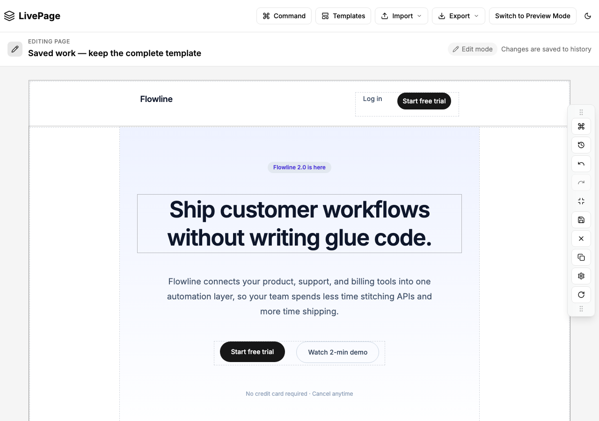
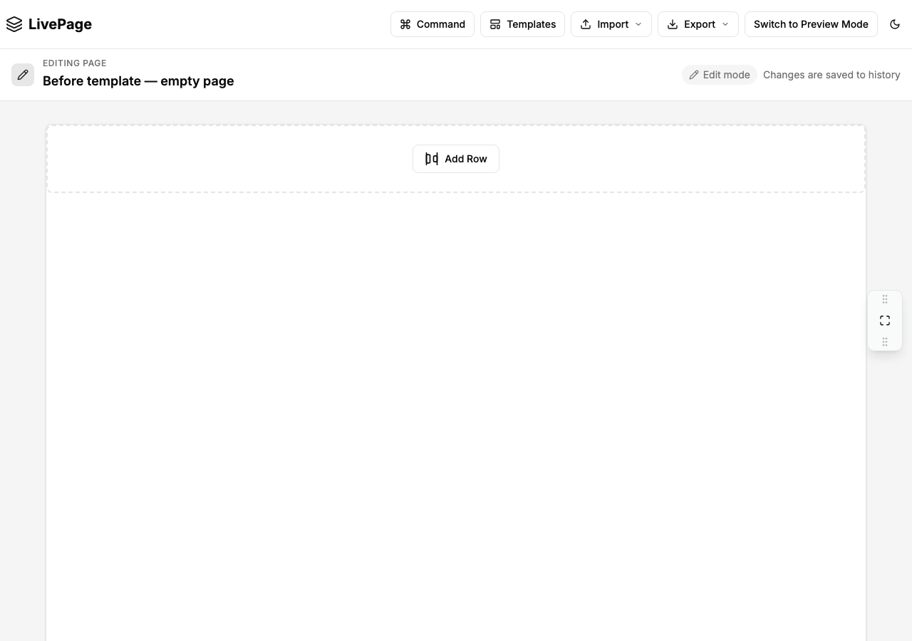

# A saved landing page rolls back after an earlier tab saves a toolbar setting

An earlier tab's **Minimize** click replaced a saved sample landing page with its
older empty page. The current stored tree went from **67 component nodes to the
page root alone**. Same-tab and newly opened-tab controls kept the complete tree.
This is an extension of [existing LivePage issue #355](https://github.com/glennfaison/livepage/issues/355),
using the app's bundled sample content rather than a single empty row.

| Saved through normal UI | After the earlier tab's save and the primary reload |
| --- | --- |
|  |  |

These are unchanged screenshots from the same local run, not an edited app or
an AI-generated mockup. Flowline is the app's bundled sample template; its
marketing text is sample content, not our product or customer results.

## Keep one test in an existing Playwright suite

The [162-line native test](livepage-template.spec.mjs) uses Playwright and Node
built-ins. It needs no App Crash Lab runner or JSON contract. It starts fresh
contexts and tests the complete saved `componentTree`, not just a title or count.
For another app, begin with the smaller [135-line example and its four adaptation
points](../tools/app-crash-lab/examples/livepage-native/README.md).

To reproduce these screenshots, use a disposable local checkout of
[LivePage at c81fc99c](https://github.com/glennfaison/livepage/tree/c81fc99ce7113de14c62a66ab25f85c02fd173de).
From that app, prepare its dependencies and start the measured production path:

```sh
npm ci --ignore-scripts --no-audit --no-fund
NEXT_PUBLIC_PROMPT_ASSIST_ENABLED=0 npm run build
NEXT_PUBLIC_PROMPT_ASSIST_ENABLED=0 npm run start -- --hostname 127.0.0.1 --port 54198
```

Our measurement reused an existing installation of the identical app lockfile;
a fresh app dependency install at this newer source pin was not repeated. App
build/setup time is outside the browser-test durations below.

In your existing Playwright project, copy the native file to
`tests/e2e/livepage-template.spec.mjs`. Use Node 22+, Playwright 1.64.0 and its
Chromium browser. Select a Chromium project and include `.spec.mjs` in your
suite's test match if your configuration requires it. Then run:

```sh
LIVEPAGE_URL=http://127.0.0.1:54198/try npx --no-install playwright test tests/e2e/livepage-template.spec.mjs --workers=1 --retries=0
```

On this unmodified pin the expected command exit is **1**: two passing controls
and one failing `PRESERVATION` assertion. No test is marked as an expected failure
or skipped. Setup errors and timeouts are not proof of a preservation failure.
Screenshots, complete checkpoints and cleanup milestones use Playwright's normal
per-test output directory.

## What the three cases do

1. Save and reload a non-default empty page.
2. In the earlier-tab case, open the peer now and verify it hydrated that page.
3. In the primary, apply **Landing Page / SaaS** through **Templates**, edit its
   title, and verify the complete saved template remains stable.
4. The same-tab control acts in the primary. The new-tab control opens its peer
   after the template is saved. In each case, **Minimize** must actually commit
   `toolbarMinimized: false → true` before comparing preservation.
5. Observe the complete tree after the commit and primary reload. A loss observed
   earlier remains a failure even if a later write repairs it.

| Case | Test result | Complete tree after reload |
| --- | --- | --- |
| Same-tab control | PASS | All 67 nodes and fields preserved |
| Newly opened-tab control | PASS | All 67 nodes and fields preserved |
| Earlier-tab regression | FAIL — `PRESERVATION` | Only the page root; previous title returned |

[Measured results and file hashes](livepage-template-proof.json) bind the test
and these two PNGs. Individual test durations were about 21s, 20s and 19s;
the whole command took 103.362s including runner/browser overhead. These are
operator measurements, not a speed or third-party adoption claim.

The final measurement disables video. Earlier optional-video runs recorded the
same rollback but stalled during recorder shutdown, so those timeout results are
not presented as completed preservation tests or published videos.

This covers one ordered two-tab localStorage flow, fresh contexts and synthetic
content. Browser HTTP is restricted to the configured loopback app origin;
service workers are blocked. Recovery from history, permanent data loss, server
conflicts and concurrent-write stress are not tested. It is not a verified
upstream fix or a maintainer execution report.

## Attribution

LivePage source and UI: [Glenn Faison's pinned MIT-licensed project](https://github.com/glennfaison/livepage/blob/c81fc99ce7113de14c62a66ab25f85c02fd173de/LICENSE).
The native test and measured screenshots are published here as a reproducible
example. Upstream notice:

```text
MIT License

Copyright (c) 2025-2026 Glenn Faison

Permission is hereby granted, free of charge, to any person obtaining a copy
of this software and associated documentation files (the "Software"), to deal
in the Software without restriction, including without limitation the rights
to use, copy, modify, merge, publish, distribute, sublicense, and/or sell
copies of the Software, and to permit persons to whom the Software is
furnished to do so, subject to the following conditions:

The above copyright notice and this permission notice shall be included in all
copies or substantial portions of the Software.

THE SOFTWARE IS PROVIDED "AS IS", WITHOUT WARRANTY OF ANY KIND, EXPRESS OR
IMPLIED, INCLUDING BUT NOT LIMITED TO THE WARRANTIES OF MERCHANTABILITY,
FITNESS FOR A PARTICULAR PURPOSE AND NONINFRINGEMENT. IN NO EVENT SHALL THE
AUTHORS OR COPYRIGHT HOLDERS BE LIABLE FOR ANY CLAIM, DAMAGES OR OTHER
LIABILITY, WHETHER IN AN ACTION OF CONTRACT, TORT OR OTHERWISE, ARISING FROM,
OUT OF OR IN CONNECTION WITH THE SOFTWARE OR THE USE OR OTHER DEALINGS IN THE
SOFTWARE.
```
