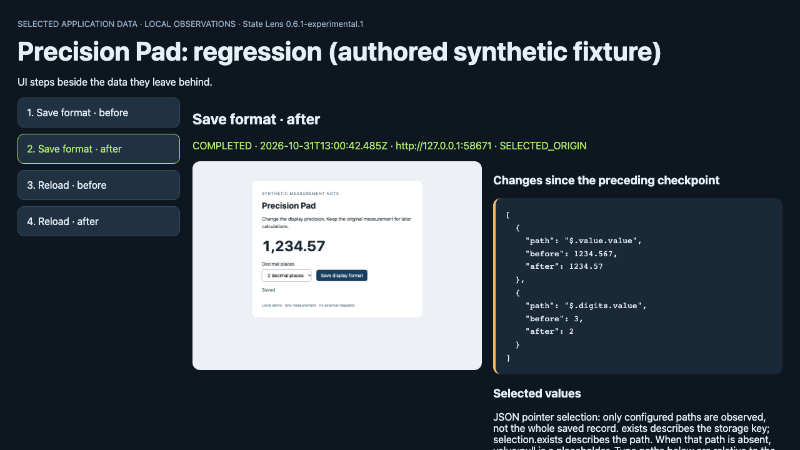

# Same screen. Different saved data.

[Open the recorded comparison](https://aichance.github.io/business-ai-recipes/state-lens-format.html) · [Actual measurements](state-lens-format-measurements.json) · [Reproduction source](../experiments/state-lens/format-integrity-case.mjs)

Precision Pad is an **authored synthetic fixture**, inspired by the distinction
between display formatting and stored values. It is not a newly discovered bug
in Sethera or another developer's app, and it is not independent adoption.

## 25-second replay with common0.6.1

[](https://aichance.github.io/business-ai-recipes/state-lens-format-v0.6.1.mp4)

[Watch the 24.92-second comparison](https://aichance.github.io/business-ai-recipes/state-lens-format-v0.6.1.mp4)
and [check its measurements and asset hashes](state-lens-format-v0.6.1-media.json).
It walks through newly measured results and the local HTML with the unchanged
common0.6.1 package. Both app screenshots match; the original-value assertion
fails only in the authored regression, with native Playwright and with Lens.
This is a recorded-results walk-through, not a live external-app capture.

The new run uses four fresh contexts, 16 native saved-state observations and
eight Lens report checkpoints. Its measurement browser is Node22.23.4 /
Playwright1.64.0 / Chromium156.0.8078.4. The replay recorder uses Python
Playwright1.63.0; that recording is not another library compatibility test.
The original0.6.0 comparison assets and the [earlier0.1 video](state-lens-demo.mp4)
remain unchanged. Neither recording counts as independent use.

To repeat the video, run the comparison command below into a new directory,
serve that output on one loopback port, then use the existing
[Demo Forge recorder](../.agents/skills/demo-forge/SKILL.md) with
[`format-replay.operation.json`](../experiments/state-lens/format-replay.operation.json),
`--url` pointing to its `state-lens-format.html`, `--narrate` and
`--tail-seconds 6`. Use a new media output directory. The operation checks the
actual revealed values and the selected after-save difference before recording
the final frame. Captions describe recorded observations; native assertions
still decide correctness. The recorder needs Python3.11+, its installed
Playwright/Chromium and FFmpeg. No account, model or API key is used.

The initial value is `1234.567`. Change display precision from three decimal
places to two, save, and reload. Both branches show **1,234.57** and **Saved**.
The normal branch preserves `value: 1234.567`; the intentionally broken branch
rounds the stored value to `1234.57`. Both store `digits: 2`.

## What was actually checked

| Check | Normal | Authored regression |
| --- | --- | --- |
| Initial display, saved status/display, reloaded status/display/precision | Pass | Pass |
| Explicit original-value assertion after save | Pass | Expected failure |
| Explicit original-value assertion after reload | Pass | Expected failure |
| Native `storageState` / `page.evaluate` / selected State Lens values | Agree | Agree |

These outcomes were measured in **four fresh browser contexts**: each branch
with standard Playwright alone and with common State Lens
`0.6.0-experimental.1`. Each context has four saved-state checkpoints. The
normal and regression screenshots, captured independently, match byte for byte
at the fixed 1080×780 viewport after save and after reload. The comparison page
uses the shared reload image; it does not manufacture two matching captures.
The JSON records the actual Node, Playwright, Chromium and library identities,
all checkpoint values, screenshot hashes, and each expected assertion outcome.

**Standard Playwright catches the same mismatch.** Keep your assertions:

```js
const saved = await page.evaluate(() =>
  JSON.parse(localStorage.getItem('precision-pad-document')));
assert.equal(saved.value, 1234.567);
```

State Lens adds selected field differences beside the viewport and actions in
one HTML report. A `COMPLETED` step means the action callback returned. It does
not mean the saved data passed an invariant. The harness checks the original
value separately and only accepts the deliberately introduced mismatch as an
expected negative control; an unrelated error fails the comparison.

[Normal timeline](state-lens-format-normal.html) · [Regression timeline](state-lens-format-regression.html)

## Reproduce

From a checkout with Node22+ and the tool's pinned development dependencies and
Chromium already installed:

```sh
node experiments/state-lens/format-integrity-case.mjs
```

The command starts a temporary loopback-only fixture, uses fresh contexts, and
prints a new output directory. It closes the server and browser on completion.
An optional directory argument must not already exist. Native traces and raw
reports remain in that local output directory; only the synthetic comparison
assets linked above were published. Capture times and temporary server ports
change on regeneration; the semantic assertions and cross-branch image hash
checks must still pass.

To observe **your own** non-sensitive, known storage key, start with the
[one-file test integration](state-lens-install.md) or
[manual checkpoint capture](state-lens-manual.md). The recorded replay requires
no account or installation to view.

## Limits

Only one synthetic numeric field, its precision setting, one browser build and
one desktop viewport are compared. This does not establish whole-app data
correctness, platform compatibility, or measured developer time savings.
Selected values and screenshots are captured sequentially; they are not an
atomic observation or a database commit timestamp. Native Playwright can read
and assert the same values. No common library, type declarations, or versioned
archive was changed for this example.
