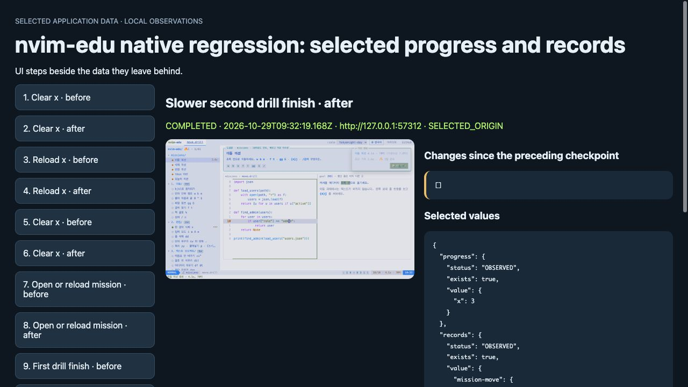
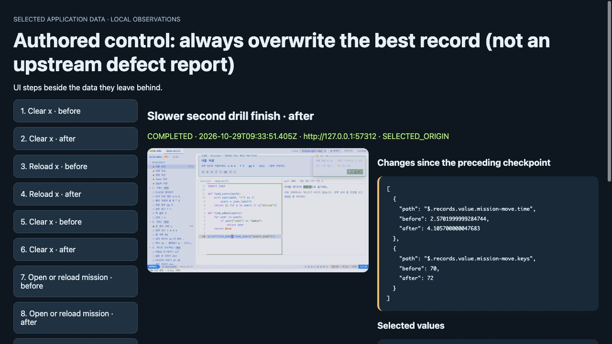

# State Lens in an existing plain-Playwright regression

An existing test already decides whether the best score survives a slower retry.
State Lens adds the selected saved record and viewport beside those actions.
This is an **operator experiment on nvim-edu with empty synthetic browser profiles**.
It is separate from the author's earlier App Crash Lab report and is not independent adoption.

[Open the normal recorded timeline](https://aichance.github.io/business-ai-recipes/state-lens-nvim-normal.html) · [Open the authored overwrite control](https://aichance.github.io/business-ai-recipes/state-lens-nvim-control.html) · [Try the common helper in your own existing test](state-lens-install.md)

## Same caller-owned assertions

Source: [s3onghyun/nvim-edu at 9c8df595](https://github.com/s3onghyun/nvim-edu/tree/9c8df5951459e491071f39452f67c4251c1d1868).
The existing [tests/regress.e2e.mjs](https://github.com/s3onghyun/nvim-edu/blob/9c8df5951459e491071f39452f67c4251c1d1868/tests/regress.e2e.mjs)
uses `playwright-core` directly. Its assertions, inputs and existing app hooks
were retained. Both variants add the same loopback context routing, desktop
Trace and cleanup in finally.

| Local source | Existing native checks | With the unchanged common helper |
| --- | --- | --- |
| Normal pinned source | 43 PASS, 0 FAIL | 43 PASS, 0 FAIL |
| Authored `isBest = true` control | 39 PASS, 4 FAIL | 39 PASS, the same 4 FAIL |

**The original test remains the pass/fail oracle.** The report's `COMPLETED`
means that an action returned. The authored control still fails four assertions.
The control deliberately overwrites the earlier best record; it is not a reported
upstream defect. The original 55 source files were restored byte for byte afterward.

## What the timeline adds

The common **0.1.0-experimental.1** file is unchanged, including its MIT license.
We selected only `nvim-edu:progress` and `nvim-edu:records`, then wrapped eight
existing UI actions with `lens.step`. Each report has 16 checkpoints/screenshots.
All selected values match eight explicit native `storageState()` captures.

At **Slower second drill finish · after**, the normal timeline has no selected
record difference. The authored control shows `mission-move.time` changing from
2.5701999999284744 to 4.105700000047683 and keys 70→72 beside the captured viewport.
Those are synthetic measured values from this control, not a timing guarantee.

| Normal source: best retained | Authored control: best overwritten |
| --- | --- |
| [](https://aichance.github.io/business-ai-recipes/state-lens-nvim-normal.html) | [](https://aichance.github.io/business-ai-recipes/state-lens-nvim-control.html) |

Native Trace remains useful for UI actions, DOM and screenshots; explicit native
storage snapshots captured the same selected values here. This example tests
packaging and the selected field-difference presentation. It does not establish
faster debugging, broader coverage, root cause or superiority over native tools.

## Inspect or reproduce this integration

Recorded setup: Node 22.16.0, playwright-core 1.64.0/Chromium, the pinned Vite app,
its inspected existing CodeMirror dependency patch and no production account.
The original script includes its existing `window.__edu` hooks. Other engines
and real Neovim correctness are outside this integration check.

For a disposable checkout of the pinned upstream source:

1. Follow upstream setup using the pinned lock, apply its existing patch and
   build. Use its installed Chromium. No new test runner is needed.
2. Save the [common module](https://aichance.github.io/business-ai-recipes/state-lens-v0.1.0-experimental.1.mjs)
   beside the test as `tests/state-lens-v0.1.0-experimental.1.mjs`.
3. Read and save [the baseline harness](state-lens-nvim-native-baseline.mjs) and
   [the helper consumer](state-lens-nvim-native-consumer.mjs) inside that same
   `tests/` directory. They retain the upstream imports and native assertions.
   The [upstream MIT license](state-lens-nvim-LICENSE.txt) and attribution are included.
4. Start the built app's preview on a free loopback port. With 4191 as an example:

```sh
npm run preview -- --host 127.0.0.1 --port 4191 --strictPort
```

In a second terminal in that disposable checkout, use a fresh result directory:

```sh
STATE_LENS_CASE_OUT="$(mktemp -d)"
STATE_LENS_BENCH_DIR="$STATE_LENS_CASE_OUT" BASE_URL="http://127.0.0.1:4191/" \
  node tests/state-lens-nvim-native-consumer.mjs
```

The directory receives `selected-state.html`, selected JSON, native snapshot
comparisons and a desktop Trace. Use another fresh directory for the baseline.
The phone-context checks also run; they are not included in that desktop Trace.
To inspect the authored control, use another disposable source copy, replace the
single `const isBest = !best || time < best.time` line with `const isBest = true`,
rebuild, and run [the control consumer](state-lens-nvim-native-control.mjs) in a
fresh output directory. Its expected native exit is 1 with four failures. Restore
the source afterward. These harnesses reproduce this measurement; the general
[own-project integration](state-lens-install.md) uses the same common helper.

## Cost and limits

Single sequential wall-clock observations were 43.958s/48.006s for normal
native/helper and 43.815s/44.000s for the authored control. Helper cases also
capture eight extra native storage snapshots for this comparison. These timings
are not isolated SDK overhead or developer time saved. Reads/screenshots can
change timing in the app, especially a timed drill or race.

The local report contains selected data and screenshots. This experiment uses
synthetic progress only. Cleanup failure branches were statically reviewed;
write/Trace failure and unresponsive-process teardown were not failure-injected.

[Machine-readable measurements and executed-body hashes](state-lens-nvim-measurements.json) · [Common-file install](state-lens-install.md) · [Original synthetic controls](state-lens-results.md)
