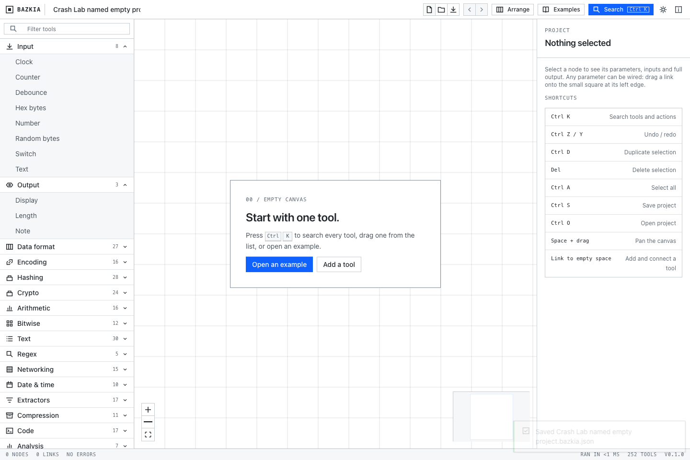
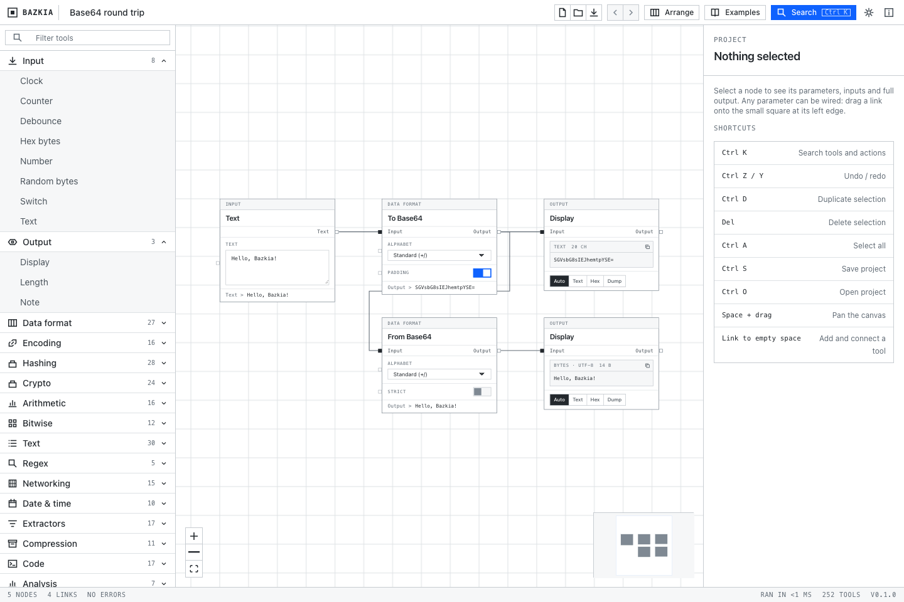

# A named empty project becomes the example after reload

A valid empty project is still saved work. On pinned **Bazkia 0.1.0 / e949745a**, its actual 113-byte JSON file restores the custom name and empty canvas, but reloading then replaces them with the default Base64 project: **5 nodes and 4 links**. A nonempty branched project is the passing control.

These are operator measurements on an unchanged disposable local browser build, with synthetic data. They are not a maintainer's run or a claim about a newer version.

| Check | Named empty project | 3-node / 2-link branch |
| --- | --- | --- |
| Reload | **FAIL** — selected saved state changes | **PASS** |
| Actual JSON export → independent fresh restore → reload | **FAIL** — import matches, then `STATE_CHANGED_AFTER_RELOAD` | **PASS** |
| Generated standalone Playwright replay | Same two failures | Same two passes |

The branch backup is 977 bytes. The empty backup is 113 bytes; its SHA256 is `ebe76186de6f9c407fba0dfdf39323d0b16ff16e9d5d60822c7c1a112e0f7ee2`.




## Reproduce manually

1. Open the pinned browser build, choose **New project**, and enter a distinct project name.
2. Choose **Save project**. Keep the actual downloaded JSON: it contains that name, `nodes:[]` and `edges:[]`.
3. Reload. The default Base64 project appears instead of the named empty project.
4. In an independent fresh browser context, **Open project** with that same unchanged file. Its name and empty canvas return; reload replaces them with the example again.

The local source suggests the branch in `src/App.tsx` is relevant: the startup fallback requires `saved.nodes.length` to be nonzero. This identifies a likely cause, not a tested patch. The app is not changed by this kit.

## Run the prepared checks

[Download the small test kit](https://aichance.github.io/business-ai-recipes/app-crash-lab-bazkia-trial-v0.1.0.zip) · [SHA256](https://aichance.github.io/business-ai-recipes/app-crash-lab-bazkia-trial-v0.1.0.zip.sha256) · [Machine-readable results](results-summary.json)

The kit contains our four JSON contracts, this guide, results, synthetic screenshots and license. It does not contain Bazkia source, credentials or personal data. Extract it into a new directory without overwriting an existing project.

For an already-running local Bazkia checkout, skip to the runner commands and use its actual loopback origin. To reproduce the pinned source in a separate directory, use **Node 24.19.0 and npm** (measured on macOS with Node 24.19.0):

```sh
git clone https://github.com/avestura/bazkia.git bazkia-local
git -C bazkia-local checkout --detach e949745ab58c01eef8534274e6625537d236ece6
cd bazkia-local
npm ci --ignore-scripts --no-audit --no-fund
npm run dev -- --host 127.0.0.1 --port 54191 --strictPort
```

Keep that local server running. In another terminal, from the extracted kit directory, install the matching Chromium once and run one failing case plus its control:

```sh
npx --yes --package=@playwright/test@1.64.0 playwright install chromium
npx --yes --package=https://github.com/aichance/business-ai-recipes/releases/download/app-crash-lab-v0.12.0-dev.2/app-crash-lab-0.12.0-dev.2.tgz app-crash-lab run reload-empty.json
npx --yes --package=https://github.com/aichance/business-ai-recipes/releases/download/app-crash-lab-v0.12.0-dev.2/app-crash-lab-0.12.0-dev.2.tgz app-crash-lab run reload-branch.json
```

The first check returns exit 1 on the pinned app; the control returns 0. This is the expected measured difference, not a reason to mark the failure skipped. On Linux, Chromium may also need its documented system libraries. If using the files directly from this repository, run from this example directory.

For an app already on another port, append `--base-url http://127.0.0.1:1420` with its actual loopback origin. **Use the 0.12.0-dev.2 prerelease**: `reload-branch.json` uses button-triggered file-chooser setup, which stable 0.11.0 does not support.

The real-file checks use the same runner command with `roundtrip-empty.json` and `roundtrip-branch.json`. They export through **Save project**, compare the entire saved project with the downloaded JSON, deliver the exact same Buffer through **Open project** in a separate context, compare all selected state after import, then reload and compare again. On the pinned app the empty case fails only at the final reload; the branch passes all phases.

A run also writes ordinary `repro.spec.mjs` and `playwright.config.mjs` files. They can be rerun with Playwright 1.64.0 as described in the [runner guide](https://github.com/aichance/business-ai-recipes/blob/main/tools/app-crash-lab/README.md).

## What the contracts cover

All of `bazkia:autosave` is compared: project format/version/name; every node ID, tool, coordinate, parameter and label; every edge ID, source/target and both handles. The UI project name and node/link counts are also compared. The full expected source record waits for the actual autosave; no added sleep or storage write is used. The fresh target's own complete default project is explicitly declared.

Both Unicode output displays were checked separately during the local diagnostic; their displayed text is **not** an assertion in these four CLI contracts. The contracts do not test all 252 tools, desktop/Tauri, malicious project files, storage quota, an edit closed before autosave, or future versions. Autosave's 600 ms debounce is not itself labelled a defect here.

The first attempt at the backup contracts selected the toast container instead of its inner message span. That completion-signal mismatch was corrected before the final results above; it is not reported as an application defect.

After a patch, rerun the unchanged empty-project case and the branch control on the new app revision. A result from our local replay is separate from independent author use.
