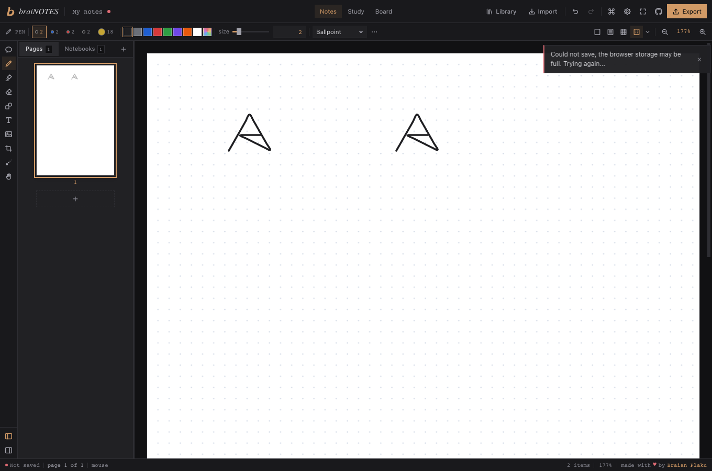
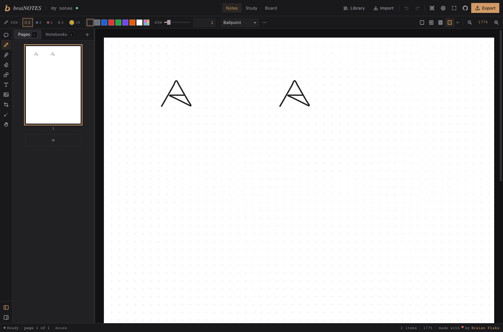

# Keep the ink when an autosave transaction aborts

**Two native Playwright checks; both pass on the measured BraiNOTES pin.**
This is a working recovery example: a real IndexedDB transaction is aborted
after its page write succeeds. The application keeps the previous saved ink,
shows a save failure, retries, and restores both strokes after reload.
We did not find a product bug in this scope.

The app is [BraiNOTES](https://github.com/swimmingbrain/brainotes) at
[`6682d327`](https://github.com/swimmingbrain/brainotes/tree/6682d3279ca95a802400148470a97bd0cdb54eb3).
It has Vitest tests; these are our separate browser tests, not an existing
upstream Playwright suite. The final operator run passed **2/2 in 16.59s**,
with all 190 original source files unchanged. Earlier setup/measurement failures
are recorded in [RESULTS.json](RESULTS.json), separately from product behavior.

| Native case | Result |
| --- | --- |
| Draw A, save and reload; draw B, save and reload | PASS |
| Draw B after a saved A; abort the actual page transaction, observe failure and unchanged storage; allow the real retry and reload | PASS |

The abort leaves B visible but explicitly unsaved:



After the application's own retry and reload, both strokes remain:



## Run the measured source

Use a disposable checkout of that exact pin, Node 22+ and pnpm. No account,
provider key, bridge or real document is needed. In the app directory:

```sh
pnpm install --frozen-lockfile --ignore-scripts
node node_modules/vite/bin/vite.js --host 127.0.0.1 --port 57973 --strictPort
```

Keep that server running. Download the
[standalone ZIP](https://aichance.github.io/business-ai-recipes/app-crash-lab-brainotes-native-v0.1.0.zip)
and [SHA-256 checksum](https://aichance.github.io/business-ai-recipes/app-crash-lab-brainotes-native-v0.1.0.zip.sha256).
Review its nine files, then in the extracted `brainotes-native` folder:

```sh
npm ci --ignore-scripts --no-audit --no-fund
npx playwright install chromium
npm test
```

Expected result on the measured pin: **two passes, exit 0**. The locked test
dependency is `@playwright/test@1.64.0`. Node 22.16.0, pnpm 12.13.0 and Chromium
on macOS were used; other versions/platforms have not been verified.
For a different loopback port, set `BRAINOTES_URL='http://127.0.0.1:PORT'`.
Use a plain local URL without credentials, bridge flags or an existing profile.

## Copy into your own browser suite

If your BraiNOTES checkout already has Playwright, copy
[autosave-abort.spec.mjs](autosave-abort.spec.mjs) into its test directory.
Include `.spec.mjs` in `testMatch` and run its Chromium project with a 60s
per-test timeout. Otherwise use the standalone setup above. No App Crash Lab
runner, JSON contract or runtime LLM is involved.

For another app, adapt the exact database/stores, real UI actions, save/error
indicator and schema together. This example requires a fresh one-notebook,
one-page state and tests two mouse-drawn strokes; it is not a generic database
test that can be pointed at an arbitrary product unchanged.

## What the assertions protect

- A is actually drawn, saved and reloaded before injection. Every field and key
  in all three IndexedDB stores is captured, including exact Blob bytes.
- The intended A+B page is cloned from the application's real native `put`
  argument **before** the abort. It is not inferred from the post-retry database.
  Existing A attributes/points and a distinct nonempty B are checked.
- Only the current page's `brainotes` readwrite transaction over `notebooks`
  and `pages` is aborted, after its native page request succeeds. No fake
  `QuotaExceededError` is thrown and the test never writes application records.
- While denied, the complete database equals the A baseline. The error title
  must appear; “Saved” cannot appear between the first abort and successful
  retry transaction completion. The completion observer is registered before
  the app's `idb` wrapper, to avoid a late-listener ordering artifact.
- After the real retry, complete page data must equal the captured intended
  write. Only `Notebook.updatedAt` may advance. Separate blank-to-ink pixel
  masks for A and B must match again after reload, alongside the stored data.
  Unclassified page errors refuse a pass.

Contexts start empty, block service workers and non-local HTTP traffic, and
allow only same-host/port root-path Vite WebSocket traffic. Closing the context
discards all injected hooks. This tests synthetic transaction abort/retry,
not real quota exhaustion, forced process shutdown, rescue recovery, PDFs or
image assets. Canvas-mask mismatch or missing setup evidence is inconclusive,
not evidence of an app bug.

These are AI-assisted operator measurements. Maintainer execution, independent
adoption and stars are separate outcomes. If you try the test on your own app,
report the app/version, result or first setup blocker; a star is optional.
