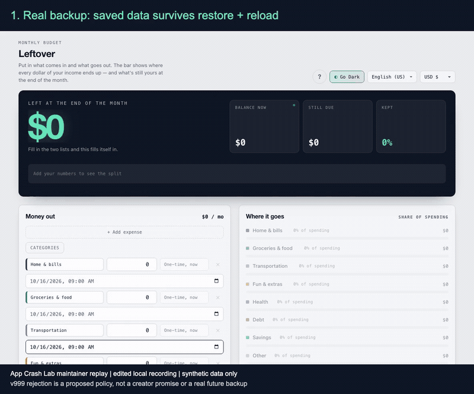

# A real backup restores; an unknown version also replaces the budget

[Leftover](https://leftover-budget.netlify.app/) is a browser-local budget app.
Its creator [describes JSON restore through the migration path](https://www.reddit.com/r/SideProject/comments/1x16lk5/i_built_a_budget_app_thats_a_single_230kb_html/).
On **2026-10-16**, a private localhost copy of the unchanged official HTML
(**build 1.5.7 · 9 Oct**, hash in [SOURCE.json](SOURCE.json)) produced:

| Check | Observed result |
| --- | --- |
| Real downloaded backup, unchanged bytes, empty new browser context | **PASS**: all of `leftover:v2`, displayed `-$25.50` balance and one History entry match after restore and reload |
| Unrelated JSON `{ "not": "a Leftover backup" }` | **PASS**: rejected; complete prior state, balance and History remain unchanged |
| Synthetic unimplemented `v: 999` with an empty `schedules` array | **FAIL** under the proposed rejection contract: no rejection; balance becomes `$0`, History becomes empty |

The last row is an explicit **proposed fail-closed policy**, not a product
promise quoted from the creator. The fixture is not a real future backup.
The normal file chooser also showed **“Backup restored”** for that fixture;
its empty balance and History persisted after a separate manual reload.
The CLI rejection check itself compares the immediate post-import state;
that separate UI check supplies the after-reload observation.

## Watch the normal-file and proposed-rejection controls

[](https://aichance.github.io/business-ai-recipes/leftover-version-boundary.mp4)

[Watch the 14-second MP4](https://aichance.github.io/business-ai-recipes/leftover-version-boundary.mp4).
Chapter 1 restores the app's real downloaded JSON in a new browser context and
reloads with the complete original state, `-$25.50` balance and one History entry.
Chapter 2 imports the declared synthetic `v: 999` fixture into the saved budget;
the app reports restoration and the replaced `$0`/empty-History state survives reload.

This is a separate **maintainer-operated Playwright re-capture**, not a recording
of the CLI, an upstream fix or a third-party trial. It uses the unchanged source
hash below, real download/file-chooser events and synthetic data only. The new
browser starts without stored origins/cookies; its tour and language preferences
are then set through the normal UI before import. Full state is compared in the
recording assertions; a video alone cannot prove every field. The two clips are
trimmed, joined and labelled; no app pixels or source are rewritten. Viewer holds
follow semantic assertions and do not substitute for persistence readiness.
[Recording scope, asset hashes and results](MEDIA.json).

## Run on the same official HTML snapshot

Use Node 22+, npm and Python 3. Keep everything in a disposable directory;
never import these fixtures into your actual budget. The HTML is **not bundled**.
The official URL can change: if its SHA-256 differs, stop and review that new
version instead of treating it as the tested snapshot.

In one terminal, download, verify and serve it. The subshell stops on failure:

```sh
(
  set -eu
  acl_leftover_dir="$(mktemp -d "${TMPDIR:-/tmp}/acl-leftover.XXXXXX")"
  cd "$acl_leftover_dir"
  curl --fail --location --output index.html https://leftover-budget.netlify.app/
  python3 -c 'import hashlib,pathlib; p=pathlib.Path("index.html"); actual=hashlib.sha256(p.read_bytes()).hexdigest(); expected="1d92a5296bad9ab1e5dfe24ad4039840269ed488206753533dc4725f2348a839"; print(actual); raise SystemExit(0 if actual==expected else "Snapshot changed: stop and review")'
  python3 -m http.server 54680 --bind 127.0.0.1
)
```

Download the three JSON configs from this folder into another disposable
working directory. Install the browser once, then run the real-file control:

```sh
npx --yes --package=@playwright/test@1.64.0 playwright install chromium
npx --yes --package=https://github.com/aichance/business-ai-recipes/releases/download/app-crash-lab-v0.10.0/aichance-app-crash-lab-0.10.0.tgz app-crash-lab run roundtrip.json --out roundtrip-report
```

Use the same run command with `reject-unrelated.json` and a fresh output folder
for the passing rejection control. Use `reject-future-version.json` and another
fresh output folder for the **expected regression failure, exit 1**. An
inconclusive run, exit 2, is a setup/coverage boundary, not a reproduced failure.
The JSON configs are newer than the 0.10.0 package and must be downloaded
separately; the pinned 0.10.0 runner executes them unchanged.

## Comparison scope

The setup uses the normal UI to add one synthetic `$25.50` food expense and
waits for **“Saved on this device”** after its normal transient message. The
first attempt omitted that readiness condition and correctly stopped at
`SOURCE_BASELINE_NOT_STABLE`; the app debounces persistence by 400 ms. The final
contract then retains full-state stability checks. No fixed sleep, storage
seeding, rewritten ID, field omission or app-source modification is used.

The actual-file control compares the complete JSON storage value against the
whole downloaded payload, uploads the original **3,136 bytes** into a separate
initially empty context, and checks all selected state plus balance and History
after reload. It also passed as a generated standalone Playwright test requiring
only `@playwright/test` 1.64.0. IDs and timestamps are generated, so download
hashes and file sizes can vary on rerun without changing the comparison policy.

The other two configs deliberately upload declared synthetic invalid fixtures;
they are **not** the unchanged real-file roundtrip. An unknown-version rejection
is a policy for the app owner to accept or replace. Backup completeness, one
malformed-input rule and crash durability are separate claims.

The run blocks external requests and service workers. Android/TWA, purchases,
exchange-rate conversion, v1 migration, actual future schemas and immediate-close
durability are **not tested**. No real financial information, upstream HTML,
private logs or browser profile is redistributed. These are maintainer-operated
local tests, **not third-party adoption**.
