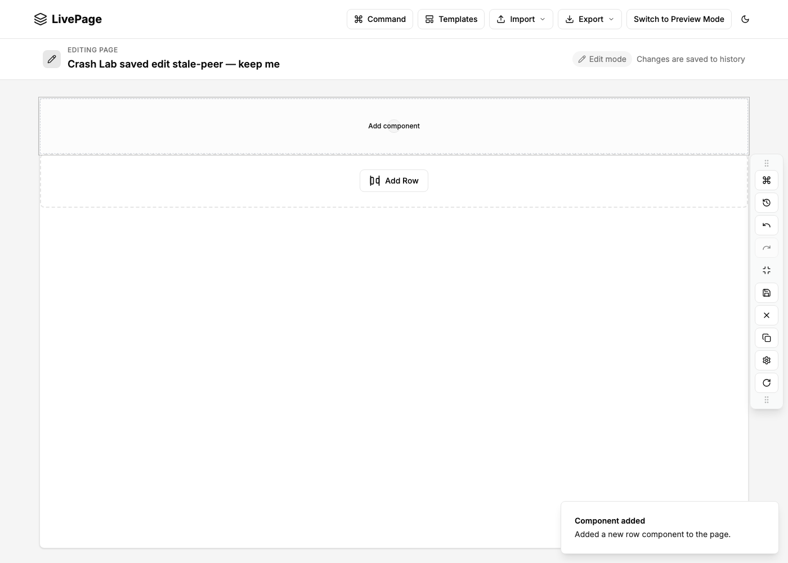
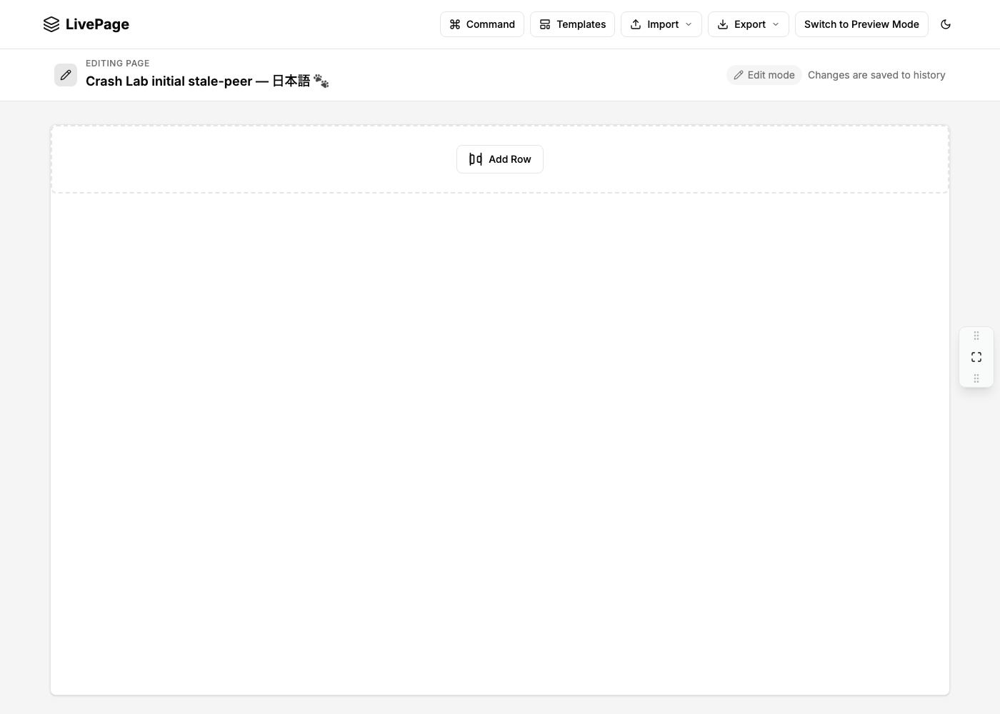

# Minimize in an earlier tab can erase a saved row

This is a runnable regression for the **existing** [LivePage issue #355](https://github.com/glennfaison/livepage/issues/355).
It supplements its source-traced report with actual local browser measurements,
not a new duplicate bug report or a claim of maintainer adoption.

Tested source: [`glennfaison/livepage` 915f828f](https://github.com/glennfaison/livepage/tree/915f828f0b8f9fabc0124c37b5d94797b2ef02e3),
version 0.1.0, Next 15.3.8, unmodified production build. Our macOS operator test
used Node 22.16.0 and Playwright 1.64.0. No account, API key, AI assistant or
hosted app was used. The app's 500 ms autosave is covered by 1000 ms observation
windows. Source files remained byte-identical to the pinned Git blobs.

| Actual UI sequence | Complete page tree after reload |
| --- | --- |
| Save a title and add a row → minimize in the same tab | Preserved |
| Save a title and add a row → open a new tab → minimize there | Preserved |
| Open a peer first → save a title and add a row in the primary → minimize in the earlier peer | Title reverted; row removed |

The peer's action changes only `toolbarMinimized`, outside the protected
`componentTree`. Its persisted `false → true` transition is checked separately.
The comparison retains **every** field of the complete tree, including generated
row IDs and attributes. It does not replace it with a title or item count.
The saved initial sentinel shown in the peer differs from the server's default
`Home Page`, proving the peer hydrated **before** the primary edit.




## Run the portable test against your own local checkout

Download the [portable trial ZIP](https://aichance.github.io/business-ai-recipes/app-crash-lab-livepage-trial-v0.1.0.zip)
and [SHA-256 checksum](https://aichance.github.io/business-ai-recipes/app-crash-lab-livepage-trial-v0.1.0.zip.sha256),
then extract it in an empty folder. It contains the unchanged generated
`repro.spec.mjs`, its exact contract, two controls, pinned Playwright metadata
and this explanation. It does not contain LivePage or a browser profile.

In a **disposable LivePage checkout**, start the local app at port 54194.
For the measured production mode on macOS/Linux:

```sh
npm ci --ignore-scripts --no-audit --no-fund
NEXT_PUBLIC_PROMPT_ASSIST_ENABLED=0 npm run build
NEXT_PUBLIC_PROMPT_ASSIST_ENABLED=0 npm run start -- --hostname 127.0.0.1 --port 54194
```

Use the pinned commit above to reproduce our result, or your newer local fix
to check whether it preserves the page. No provider credential is needed.
In a second terminal, inside the extracted trial folder:

```sh
npm ci --ignore-scripts --no-audit --no-fund
npx playwright install chromium
npm test
npm run controls
```

On the pinned app, `npm test` is expected to fail because the saved page tree
changes. Both controls should pass. After a fix, rerun the same unmodified
`npm test`; a passing result requires the peer commit and the complete protected
tree to survive reload. Linux may need Playwright's system browser libraries.
The test uses a fresh isolated context and synthetic title/row data, never your
normal profile. Review the attached JSON before sharing test output.

## Configure the same pattern for another app

From the current App Crash Lab source checkout (0.12.0-dev.3 prerelease):

```sh
node cli.mjs run examples/livepage/stale-tab.json --out .crash-lab/livepage-trial
```

[`stale-tab.json`](stale-tab.json) is the full declarative contract. Adapt its
ordinary UI steps, initial sentinel, persisted save guard and **disjoint** peer
commit to your own app. The default reload/rejection checks are unchanged.
See the [contract and boundaries](../../CONTRACT.md#earlier-tab-saving-a-disjoint-field-0120-dev3-prerelease).

This checks one ordered, same-origin, two-page localStorage interaction. It is
not a simultaneous-write stress test, server conflict test, IndexedDB test,
whole-app data guarantee or proof that a third party ran the tool. Missing
hydration, primary save or peer commit produces INCONCLUSIVE. Unexpected
native dialogs also invalidate the check. Writes outside the explicit windows
are not covered. The upstream app was not patched for these measurements.

Measurements: [results-summary.json](results-summary.json).
