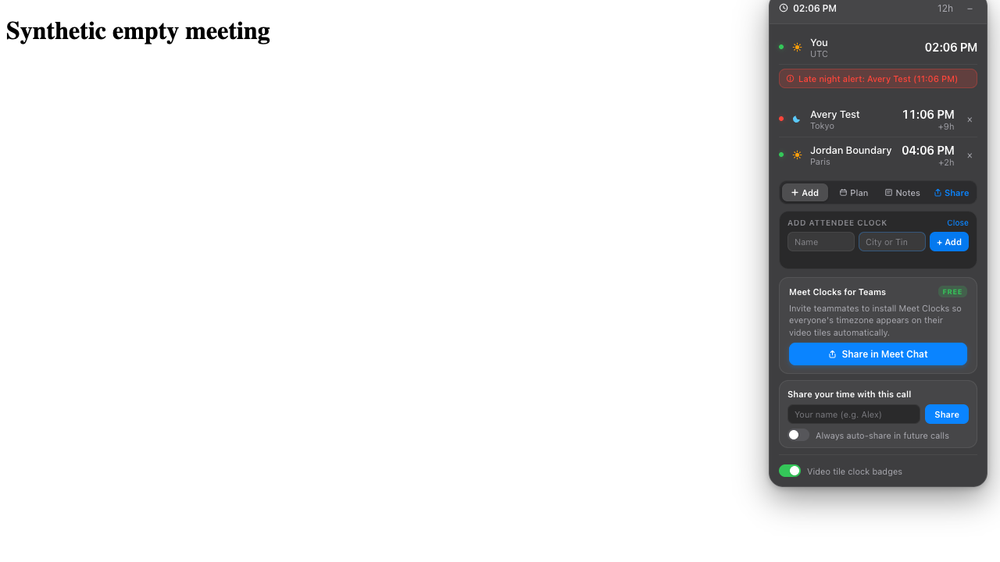
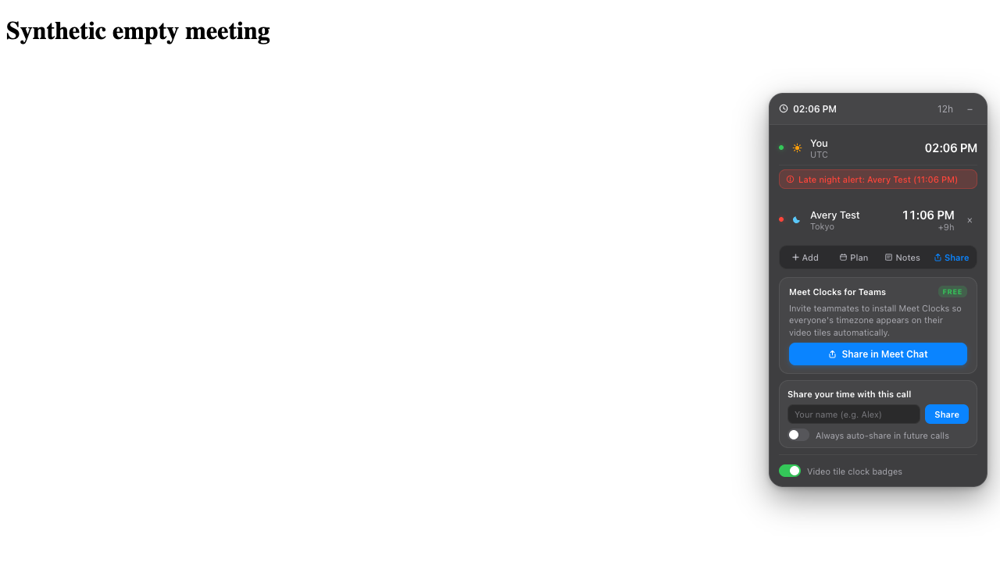

# A new clock appears, then disappears after reload

Meet Clocks stores preferences, visible attendee clocks and its address book in
one `chrome.storage.sync` item. With a valid item close to Chrome's 8 KiB
per-item limit, adding one ordinary attendee displays a clock but rejects the
save. There is no visible error; reloading removes **the new unsaved clock**.
Every field of the previous saved record remains intact.

| Before reload: Jordan appears without a save error | After reload: only the previously saved Avery remains |
| --- | --- |
|  |  |

Measured on unmodified [mamarezza/meet-clocks](https://github.com/mamarezza/meet-clocks/tree/e7fafc7ad7cfb46c9677fb0a4f2ab1e452fb681e),
manifest version **0.9.2**, using Playwright 1.64.0 and bundled Chromium
156.0.8078.4 on macOS arm64. This is the unpacked GitHub source, **not a test of
the Chrome Web Store package or a live Google Meet call**.

## Run three ordinary Playwright tests

The upstream project has Python/CDP QA, not an existing Playwright Test suite.
This is a separate small test package; it needs Node 22+, npm and Playwright's
Chromium. It needs no App Crash Lab runner, JSON contract, Google login, relay
or API key. Review the [single test file](sync-quota.spec.mjs) before running it.

From this example directory, use a disposable upstream checkout:

```sh
git clone https://github.com/mamarezza/meet-clocks.git meet-clocks-source
git -C meet-clocks-source checkout --detach e7fafc7ad7cfb46c9677fb0a4f2ab1e452fb681e
npm ci --ignore-scripts
npx --no-install playwright install chromium
MEET_CLOCKS_SOURCE="$PWD/meet-clocks-source" npm test
```

At this source pin, the expected outcome is **2 passed, 1 failed, exit code 1**.
The failure is the missing visible save-error feedback. It is deliberately not
marked as an expected failure: a future correctly handled refusal should turn
the same assertion green. To check a fix, point `MEET_CLOCKS_SOURCE` at its
separate checkout. Test outputs contain full synthetic storage observations and
before/after screenshots. Each browser uses a new profile which is removed on
exit; no existing Chrome, debug port or browser profile is used.

| Case | Observation | Result on the pin |
| --- | --- | --- |
| Normal UI add → reload | The complete 216-byte saved record and clock survive | PASS |
| Valid near-limit record → same-size format edit → reload | Every field except the intended `fmt` change survives | PASS |
| Same valid record → add Jordan | Real Chrome rejects the write, every old field survives, but no visible failure appears | FAIL |

The final case observed **8,166 bytes → attempted 8,278 bytes**, against the
actual API's **8,192-byte** per-item quota. Chromium emitted two
`Resource::kQuotaBytesPerItem quota exceeded` Promise errors because the add
flow attempts two saves. These errors are observed, not injected. The test also
accepts a handler that catches the rejection and shows failure without an
unhandled exception. See [RESULTS.json](RESULTS.json).

## What is real, and what is a fixture?

- The original manifest, content script, UI, save/load logic and Chrome storage
  API are real. No storage function is replaced and no quota error is mocked.
- The host document at the matching Meet URL is controlled empty HTML. All other
  intercepted page requests are blocked. No real meeting, camera, microphone,
  relay or signed-in account participates. Cross-device Chrome synchronization
  is not tested; the signed-out profile still enforces the sync area's quota.
- A valid complete near-limit record is seeded with one **real API write**. It
  has one visible attendee and 107 synthetic address-book entries, rather than
  107 attendees in a meeting. The final additional attendee uses the actual UI.
  This contact count is fixture-specific; byte size is the relevant boundary.
- Comparisons keep all persisted fields. Only `shared` is excluded, exactly as
  upstream's save function intentionally does. This does not demonstrate loss
  of previously saved data, cloud-sync conflicts or general Meet compatibility.

The upstream offline HTML test replaces storage with an always-successful memory
object, so it cannot cover this Chrome API limit. This package adds that missing
boundary without running upstream's fixed-port Chrome/CDP launcher.

Chrome documents the quota and Promise rejection behavior in its
[storage API reference](https://developer.chrome.com/docs/extensions/reference/api/storage).
Playwright documents why unpacked extensions use a
[persistent bundled Chromium context](https://playwright.dev/docs/chrome-extensions).

Tests and measurement notes: MIT, App Crash Lab. Upstream: MIT, Meet Clocks by
mamarezza; no upstream source is redistributed here.
