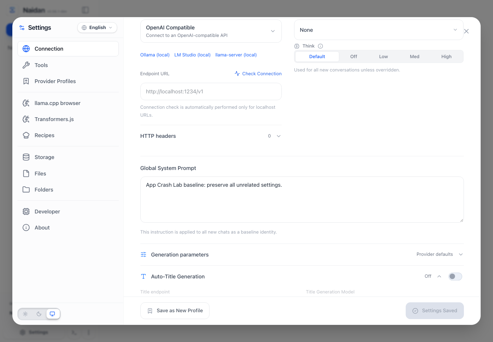

# Turning off auto-title can undo another tab's saved system prompt

On unchanged [Naidan `78f207e7`](https://github.com/nwtgck/naidan/tree/78f207e7ac4e3346ab8e4b0063b1187e14ccf6f7), open Connection settings in two tabs. Save a new global system prompt in the primary tab. In the earlier tab, only turn off Auto-Title Generation and save. The new prompt is replaced by the earlier prompt, including after the primary tab reloads.

**Same-tab and newly opened peer controls PASS; the earlier-peer preservation check FAILS.** This is another app-specific use of the [existing two-tab native check](../livepage-native/README.md), not a new runner. It uses Naidan's official standalone HTML and first-run LocalStorage mode. No account, LLM endpoint, API key, model download, or injected storage record is needed.

## Try it against your disposable standalone build

Use an unused directory for this [small test ZIP](https://aichance.github.io/business-ai-recipes/app-crash-lab-naidan-native-v0.1.0.zip), or copy this directory from the source checkout. It contains the test and its locked Playwright dependency, not the app. Review the files first. With Node 22+:

```sh
cd naidan-native
npm ci --ignore-scripts --no-audit --no-fund
npx --no-install playwright install chromium
NAIDAN_STANDALONE_FILE=/absolute/path/to/naidan/dist/standalone/index.html npm test
```

Set the environment variable to an existing **local HTML file** from a disposable Naidan build. The test converts it to a `file://` URL and uses `#/?storage-type=local`, the app's documented first-run selection. It launches fresh contexts with no existing cookies or browser storage; it does not use your ordinary browser profile. HTTP(S) requests are blocked and any attempted request fails the scenario precondition. Do not point an adapted test at a real user session or copy credentials into it.

Expected on the measured source:

```text
control single       PASS
control fresh-peer   PASS
regression earlier-peer  FAIL: PRESERVATION
```

Exit **1** with the **`PRESERVATION` assertion** means the preservation regression was detected. It is not skipped or marked as an expected failure. A repaired app should pass all three cases. Exit 1 can also indicate a missing file, failed startup, or unestablished real save; those setup/precondition failures are not evidence of prompt loss. `npm run controls` runs only the two controls. Full synthetic settings and screenshots are attached under `.crash-lab/native-results`; use Playwright's reporter options if you want a standalone JSON report.

If the app already has a compatible `@playwright/test` suite, copy only [stale-settings.spec.mjs](stale-settings.spec.mjs) to an unused discovered test path and set the same environment variable. Review your suite's test matching and browser settings first. The isolated package was measured with Playwright **1.64.0**; compatibility with other versions is not claimed.

## Measured behavior

| Tab changing only auto-title | Prompt in actual primary commit | Prompt after that save and primary reload | Result |
| --- | --- | --- | --- |
| Same tab | New primary prompt | New primary prompt | PASS |
| Peer opened after the commit | New primary prompt | New primary prompt | PASS |
| Peer settings opened before the commit | New primary prompt | Earlier baseline prompt | FAIL |

The test reads `naidan:lsp:settings` and confirms the entire real primary commit is visible to both documents before the peer saves. The peer's auto-title change must actually commit as `titleGeneration: "disabled"`. Every other settings field is compared, after the save and again after the **primary** document reloads. It does not infer persistence from a toast or compare only a count. A future fix may synchronize the peer's form; the test does not force stale state. An earlier-peer save may also visibly refuse the conflict, provided the complete original settings survive and a fresh, specific app dialog explains the refusal.



[RESULTS.json](RESULTS.json) binds the exact script hash to the three complete synthetic observations. Both controls and the regression reached their actual auto-title commit; no refusal branch, external request, uncaught page error, or native dialog occurred. On the pin the only unexpected settings difference was `systemPrompt`. There is no claim that the maintainer has run or adopted this test.

## Reproduction provenance and limits

We downloaded the official source archive at the immutable commit above and verified **all 24,302 original Git blobs** before installation and after the build. No app source was changed. Dependency installation used `npm ci --ignore-scripts --no-audit --no-fund`, with task-local configuration, public HTTPS Git access, and no inherited npm/Git credentials. The first `build:standalone` stage of `npm run build:all` succeeded and produced the tested HTML. Naidan's archive build correctly reports its embedded source identity as unknown; the independently checked archive pin supplies the provenance.

The subsequent **hosted** build failed its existing gzip fingerprint check for a Transformers WASM asset. That guard was not disabled or modified. The successful standalone artifact is the one tested here; the overall `build:all` command is not reported as a pass. To rebuild just this supported mode in your prepared Naidan checkout, run `npm run build:standalone`. Public Git dependencies may need HTTPS access if your environment does not have GitHub SSH configured.

This checks an ordered Connection-settings conflict in Chromium's `file://` LocalStorage mode. It does not test OPFS/default-storage mode, chat content, inference, simultaneous writes, all browsers/locales, or a fix. Chromium logged the app's non-fatal OPFS detection warning in file mode during startup; actual LocalStorage mode and normal persistence were confirmed separately. The upstream app and this test are MIT licensed; upstream source is not bundled.

For another app, keep the real UI workflow, complete persisted record, actual peer commit, and both controls. [Report your own-app run or first setup blocker](https://github.com/aichance/business-ai-recipes/issues/new?title=Native%20settings%20preservation%20test%20result) with the app/version, command, adaptations and actual result.
