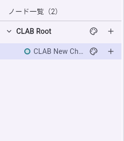
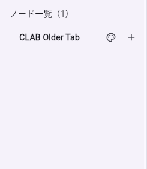

# Renaming a root in an older tab removes a saved child

NEBULARK is a local-first mind-map app. In the measured public web deployment,
tab A saves a new child, then tab B (opened before that child existed) renames
only the root. The saved graph changes from **two nodes to one**. Tab A still
shows its cached child until reload, when the child disappears.

| Saved in tab A before the peer edit | Reloaded after tab B renames only the root |
| --- | --- |
|  |  |

This is an observation of [the public web app](https://nebulark.app/), not a
source-code audit. No public source commit was supplied in the
[author's introduction](https://qiita.com/aburachudoku/items/a6d87871114d48deac8c).
The deployed `main.dart.js` used for the measurement has SHA-256
`799b678a90879a410138ba0118980462fd871595060766d1da2027c35212e295`.
See [RESULTS.json](RESULTS.json) for times, complete protected records and limits.

## Run the three browser regressions

[Download the seven-file ZIP](https://github.com/aichance/business-ai-recipes/raw/refs/heads/main/docs/app-crash-lab-nebulark-native.zip)
and [check its SHA-256](https://github.com/aichance/business-ai-recipes/blob/main/docs/app-crash-lab-nebulark-native.zip.sha256).
Extract it and enter `nebulark-native`. Alternatively, clone this repository
and enter `tools/app-crash-lab/examples/nebulark-native`. It is a separate ordinary
Playwright package, with Node 22+ and npm as prerequisites:

```sh
npm ci --ignore-scripts
npx --no-install playwright install chromium
npm test
```

Review [the single spec](stale-tab.spec.mjs) first. It creates a fresh disposable
browser context and synthetic nodes through the real app UI. It does not use
an existing browser profile, account, AI feature, API key or App Crash Lab
runner. It downloads the public app, Flutter renderer and fonts; other
requests are blocked. Storage methods and errors are **not mocked**.

At the measured deployment, the result is **2 passed, 1 failed; exit code 1**.
The last case asserts preservation of the saved child; it is not marked as an
expected failure. A fixed deployment should make that same assertion pass.
To require the historical bundle rather than whatever is currently deployed:

```sh
NEBULARK_EXPECT_MAIN_SHA=799b678a90879a410138ba0118980462fd871595060766d1da2027c35212e295 npm test
```

Leave that variable unset when checking a new deployment or fix. Each result
includes the actual downloaded bundle hashes and full synthetic raw/decoded
storage observations. Changing app UI, localization or storage schema can
require adapting this app-specific spec; a locator timeout is not evidence of
data loss. The fixed fixture is a 1280×900 viewport, Japanese locale and UTC.
Flutter accessibility is enabled through its own existing UI handler. Tab
switches use `bringToFront`; title changes click the real inline editor,
use keyboard events and wait for that editor to close before reading storage.
Two rendered frames allow Flutter to bind focus and accept the typed value;
this wait changes no application state. Screenshots wait for fonts/rendering. The inline editor is distinguished from the identically
labelled memo field by its observed position within this fixed layout.

| Case | Complete saved records after rename and reload | Result |
| --- | --- | --- |
| Same tab adds the child, then renames root | Both nodes and all protected fields remain | PASS |
| Second tab opens after the child was saved, then renames root | Both nodes and all protected fields remain | PASS |
| Second tab opens before the child, then renames root | Child record is absent, root child list is empty; same map/index | FAIL |

All comparisons retain every child field, every root field except the intended
title/edit timestamp, the entire map index and the node-ID set. The test reads
the app's actual `flutter.mindmap_index` and `flutter.mindmap_nodes_<map ID>`
localStorage values, including Flutter's encoded representation. It does not
seed or replace storage. Before the peer edit, tab B's actual UI is separately
confirmed to contain only the original root. Normal foreground switching is
part of the failing case.

The author reports 1,118 Flutter tests. We did not run that suite and do not
claim that this browser case is equivalent to it. This is not a test of the
JSON backup path, AI feature, mobile app, cloud sync, or a general Flutter bug.
There is no demonstrated third-party adoption from our own execution.

## 日本語の操作手順

1. 新しいブラウザ環境で NEBULARK を開き、親ノード名を変更する。
2. 子ノードを作る前に、同じアプリをもう1つのタブで開く。
3. 最初のタブで子ノードを追加し、名前を付けて保存されたことを確認する。
4. 前から開いていたタブへ切り替え、親の名前だけを変更する。
5. 最初のタブを再読み込みし、子ノードの保存内容を確認する。

測定時は手順5で子ノードが消えました。同じタブでの編集と、子の保存後に
開いた新しいタブからの編集では、保存済みの全フィールドが残りました。
このテストと結果は MIT。アプリのソースや配布 bundle は同梱していません。
