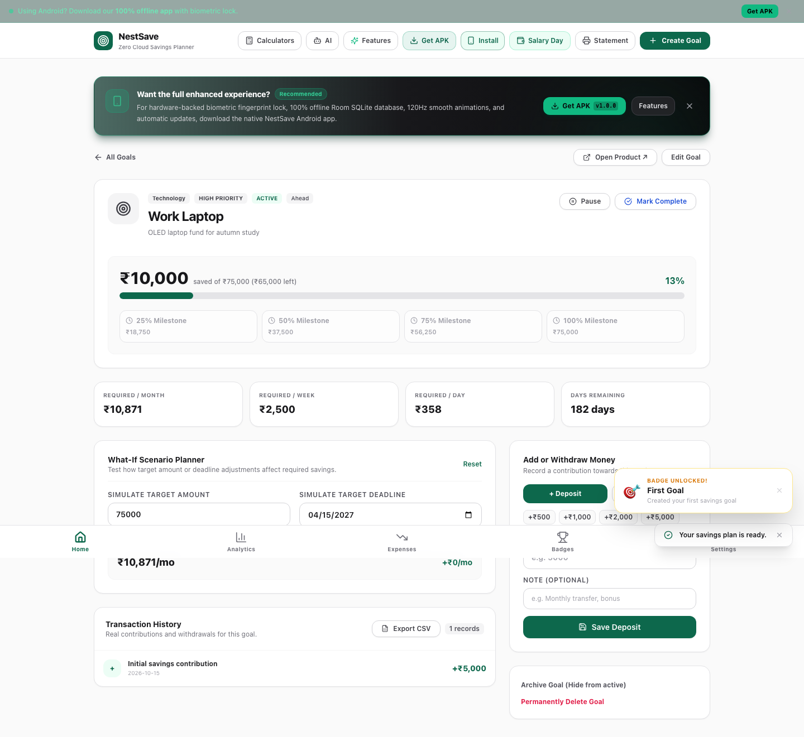

# NestSave: full generated-ID records through a real JSON backup

Requires App Crash Lab **0.9+**. This operator compatibility check uses an
unchanged local [NestSave Savings Planner](https://github.com/jojin1709/NestSave-Savings-Planner)
at `7fb4f23e0dcc835ef7b2813b6f440ff3038e5eae`, with synthetic records only.
It is not evidence that NestSave's author has used App Crash Lab.

The [contract](roundtrip.json) creates a goal, two contribution transactions,
an expense, a monthly budget and preferences through the normal UI. It reads
the complete four inline-ID IndexedDB stores plus the full `app_settings`
value. The original JSON download must contain those same records and IDs;
it is delivered unchanged to a separate fresh browser context. Full selected
values must match after import, before navigation, and after reload.

The app exports some arrays sorted by dates. `field: "records"` compares full
keyed record sets, so outer array order is outside this check. It preserves
every ID, field and nested array order. Each store is bounded at 128 records
and 262144 UTF-8 JSON bytes. Records with unsupported values are inconclusive,
not rewritten to make a match.

## Start a disposable local app

Node22+ and npm are required. Use a new folder, not your daily financial data:

```sh
git clone https://github.com/jojin1709/NestSave-Savings-Planner.git nestsave-local-test
cd nestsave-local-test
git checkout --detach 7fb4f23e0dcc835ef7b2813b6f440ff3038e5eae
npm ci --ignore-scripts
NEXT_TELEMETRY_DISABLED=1 npm run build
npm run start -- -H 127.0.0.1 -p 54594
```

Leave that server running. In a second terminal, save this example's
`roundtrip.json` in a new working folder and run:

```sh
npx --yes --package=@playwright/test@1.64.0 playwright install chromium
npx --yes --package=https://github.com/aichance/business-ai-recipes/releases/download/app-crash-lab-v0.9.0/aichance-app-crash-lab-0.9.0.tgz app-crash-lab run roundtrip.json
```

Use only the configured loopback origin. External HTTP and service workers
are blocked by the runner. A blocked font is separate from a failed save.
Build/startup errors remain setup failures. Stop the app server you started
when finished. Source identity and its MIT notice are in [SOURCE.json](SOURCE.json)
and [LICENSE.upstream](LICENSE.upstream).

For the generated standalone tests, copy the printed `repro.spec.mjs` and
`playwright.config.mjs` into another new folder. Install the test dependency
there with `npm install --ignore-scripts --no-save --no-package-lock --no-audit
--no-fund @playwright/test@1.64.0`, then run
`npx playwright test --config playwright.config.mjs`. Keep the app server running.

## Fresh context means explicitly initialized preferences

`restore.prepare` opens Settings, confirms the four controls are initially
blank, then saves synthetic capacity values `40000 / 10000 / 1000 / 2000`.
The contract declares that complete initial preferences object. All four
business-record stores must still be empty. The backup must overwrite those
preferences with the source values and restore every selected record.
There is no storage seeding, app patch, native confirmation or repair after import.

Why initialize the preferences: on this pin, saving blank/zero capacity inputs
stores own `undefined` properties in IndexedDB. The strict JSON observer cannot
represent them. That route remains INCONCLUSIVE; it is not normalized into a
passing test. The same applies to blank optional goal fields. This example
uses the normal UI to supply the goal's product URL, note and recurring amount/
frequency. It does not claim arbitrary NestSave records are JSON-compatible.

## Scope and a separate arithmetic finding

This pin displays `10000` after entering `Already Saved = 5000`, and `12000`
after adding `2000`, while its two transaction amounts sum to `7000`.
The pinned creation path stores `currentAmount = 5000` and then adds the initial
contribution again. Those are the observed values asserted by this preservation
contract, **not a claim that the amounts are correct**. Backup preservation and
arithmetic correctness are separate checks. After correcting that behavior,
review the contract's visible amount expectations for the new app version.



The separate [initial-deposit.spec.mjs](initial-deposit.spec.mjs) uses only
Playwright. On this pin, the `5000` assertion fails with actual `10000`; the
`0` control passes. It asserts the intended original value, so both tests can
become green after an app fix. This arithmetic reproduction is separate from
the passing backup-preservation checks. In a new folder, copy that spec and
its [config](playwright.config.mjs), install `@playwright/test@1.64.0`, and run
`npx playwright test --config playwright.config.mjs` with the same local app
on port54594. Expected exit on the pinned source is1, with one failed case and
one passing control. This observed discrepancy is not an author-confirmed fix.

The test covers only selected exported domains. Streak/badges localStorage
metadata is outside the app's plain JSON export. Non-created milestone fields,
encrypted vaults, Android storage, power loss and arbitrary export ordering
are not verified. IDs and timestamps are generated normally and differ per run;
never hard-code another run's backup hash or IDs. Keep raw reports/traces private
when adapting the normal reload check to real app data.
