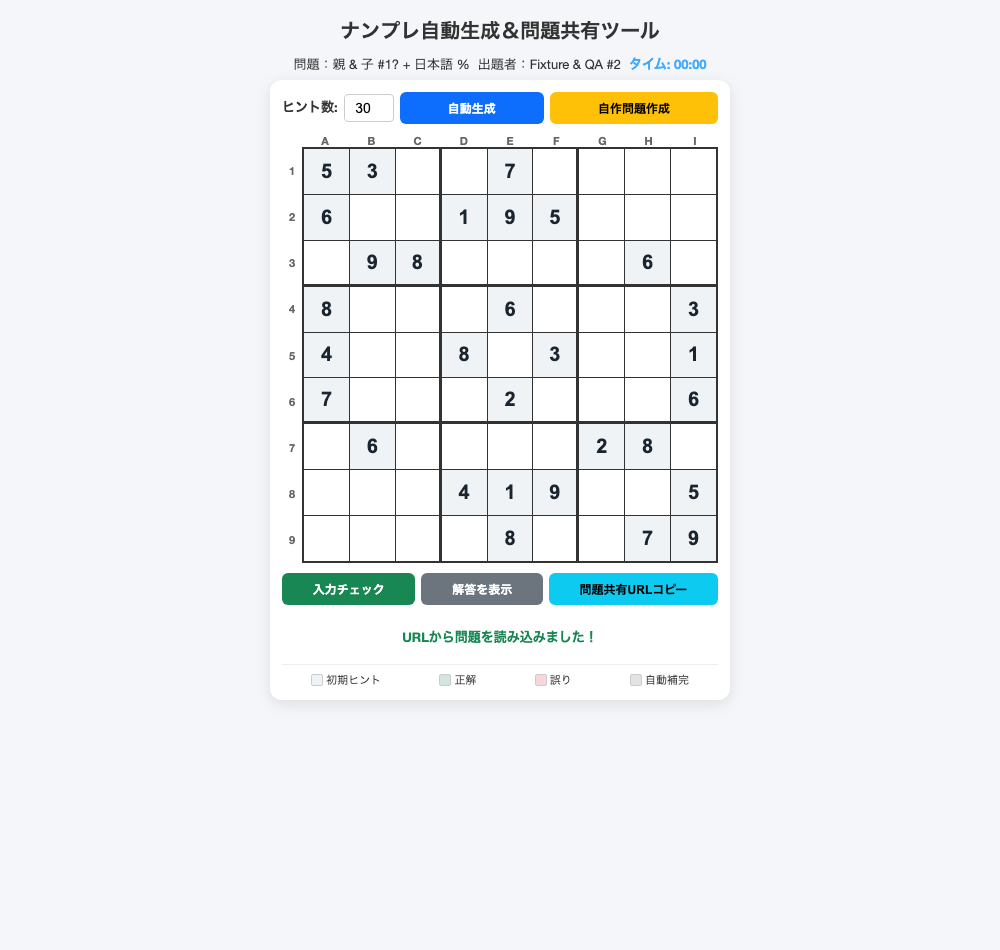
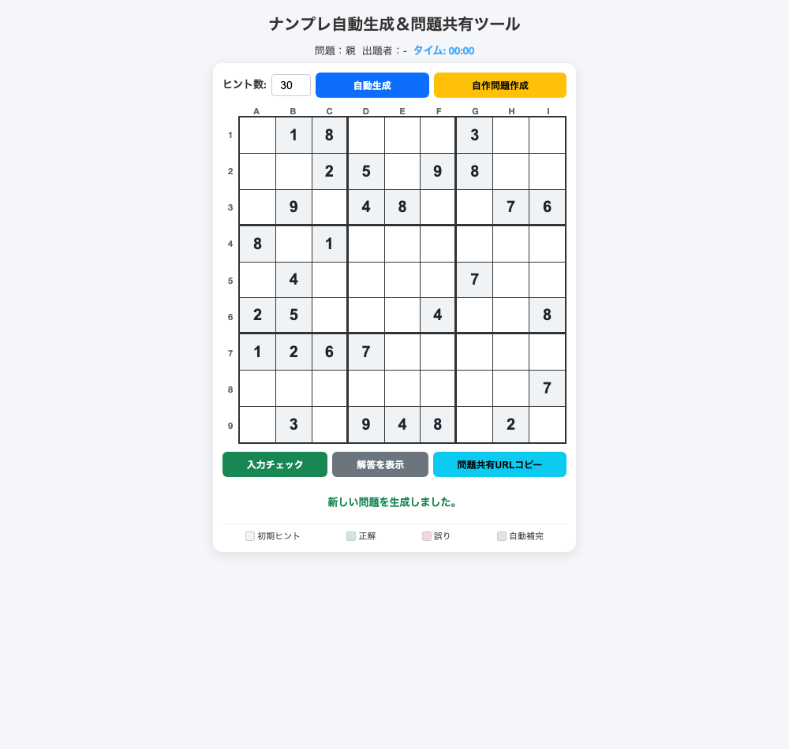

# Re-sharing the puzzle changed the puzzle

**A correctly encoded NumberPlace URL loads all 81 cells. Copying it again with
the app's share button loses its board data when the title contains `#`.**

This standalone Playwright test compares the entire board, title and author
after a real clipboard copy, a fresh browser context and reload. It needs no
App Crash Lab runner or JSON contract. Reuse an existing Playwright installation.

## Measured on the unchanged source

The [author's article](https://qiita.com/NAS6mixfoolv/items/035a8294dbb0a708829f)
describes a vanilla-JavaScript puzzle with URL-based sharing. We downloaded the
[original HTML](https://nas6.net/NumberPlace000.htm) on 2026-10-22 and kept its
bytes unchanged. Source SHA-256:

```text
663372bbae5ce8a6903035551d150b19ab12438d4f45d14c438b986e1a38bc9e
```

| Scenario | Fresh context and reload |
| --- | --- |
| Actual share button, ordinary title/author | PASS: all 81 cells and both fields preserved |
| Actual share button, title `親 & 子 #1? + 日本語 %`, author `Fixture & QA #2` | FAIL: copied URL has no `data` query field; title becomes `親`, author becomes `-`, and a new puzzle is generated |
| Same special fields, independently encoded reference URL | PASS: all 81 cells and both fields preserved |

On this recorded run the failed share changed 46 of 81 cell positions in the
fresh context and 47 after reload. The new puzzle is random; these counts are
measurements, not fixed expected outputs. See [complete states](RESULTS.json).
Every source page first matched the independently specified 81-cell fixture.
There were no page-script errors. Tested Node 22.23.4, Playwright 1.64.0 and
Chromium 156.0.8078.4; the regression command exits 1 on this affected snapshot.

| Correctly received URL, before re-sharing | App-copied URL, opened in a fresh context |
| --- | --- |
|  |  |

## Run or keep the regression

Review [share-url.spec.mjs](share-url.spec.mjs), the small
[configuration](playwright.config.mjs) and [source fetcher](fetch-source.mjs).
The test never modifies the app's JavaScript or replaces its clipboard API.
It serves only the hash-checked HTML on a temporary loopback port, blocks
external requests and disables the original analytics/background image.
No upstream app source is redistributed here.

From this repository's `tools/app-crash-lab` directory, with its Playwright and
Chromium prerequisites already installed:

```sh
node examples/numberplace-native/fetch-source.mjs
NUMBERPLACE_HTML="$PWD/.crash-lab/numberplace-upstream/NumberPlace000.htm" \
  npx --no-install playwright test --config examples/numberplace-native/playwright.config.mjs
```

The fetcher preserves an existing file and refuses a changed upstream hash.
Alternatively place a reviewed copy at your chosen path and set
`NUMBERPLACE_HTML` to that absolute path. To test a later author fix, review
that file first and explicitly set `NUMBERPLACE_EXPECT_SHA256` to its new hash.
Do not silently treat a changed page as the measured snapshot.

For an existing app test suite, copy the single spec and adapt its normal UI
actions, independent fixture and complete state reader. The supplied config
just selects this example and one worker; it is not required when your own
suite already does that. Screenshots and complete JSON observations go into
the configured Playwright output directory. `NUMBERPLACE_OUTPUT` overrides
this example's default `.crash-lab/numberplace-native` location.

## What the failure means

The received reference URL encodes each field. The share function concatenates
the displayed title and author directly into another URL. The `&` separates
parameters and `#` begins a fragment, so the board data falls outside the query
read by the app. Having 81 inputs on both screens does not prove the same puzzle
arrived. Constructing fields with `URL.searchParams.set` is one candidate fix;
the passing reference-URL control **does not verify an app fix**.

This is a local UI/URL transfer measurement using synthetic puzzle data. It
does not test the production site's entire environment, all Sudoku solutions,
in-progress save durability, a JSON backup, mobile clipboard support or an
independent author execution. The normal copy flow is deliberately tested
separately from the reference URL rather than hidden behind a patched app.
