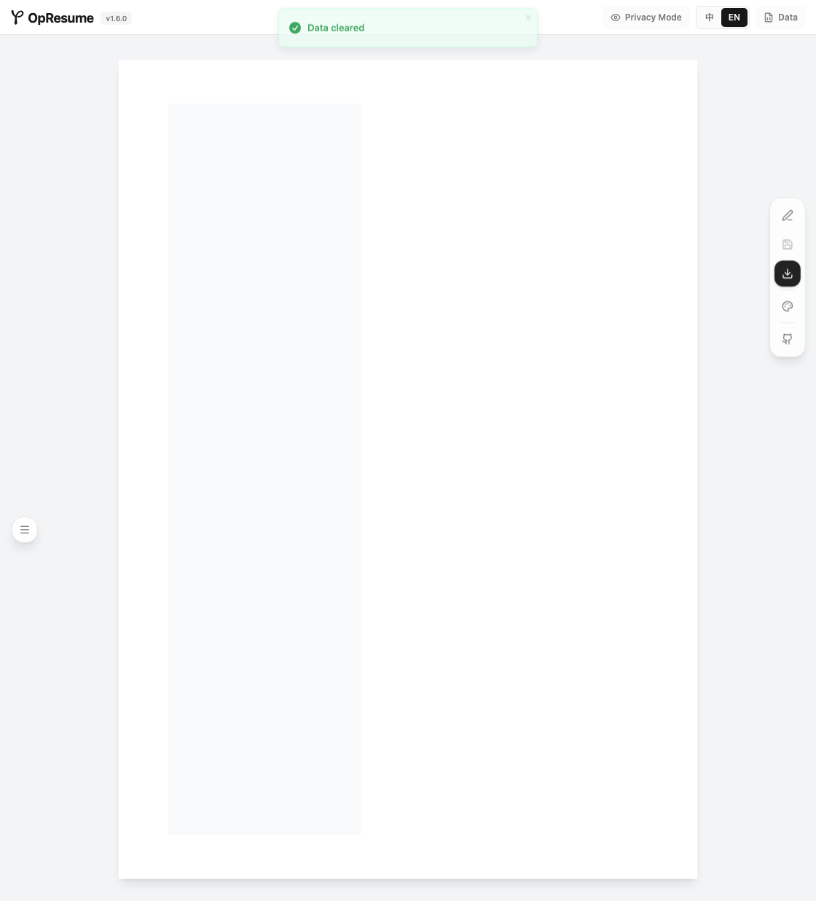
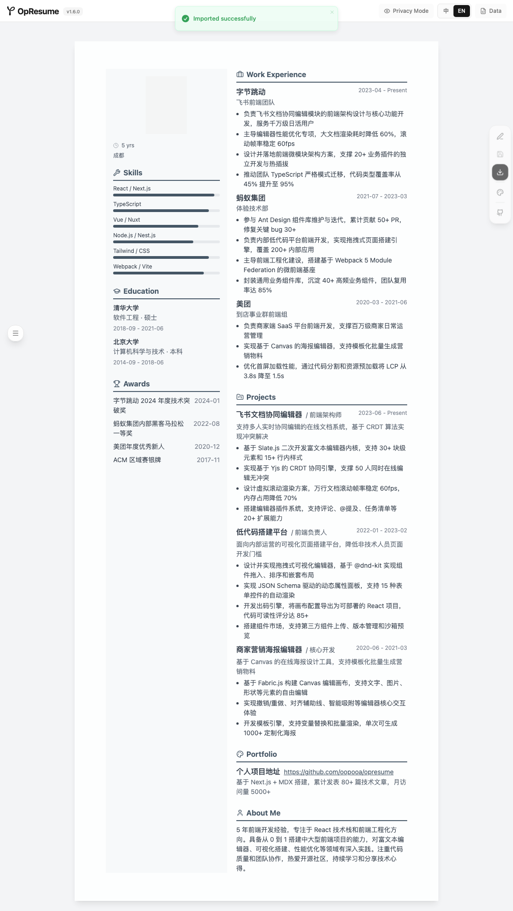

# “Overwrite succeeded” can leave example jobs in an empty resume

On pinned **OpResume 1.6.0 / `57eae263`**, **Clear Data → Export JSON** produces a valid 66-byte backup. Importing those unchanged bytes in a fresh browser reports **Imported successfully**, but keeps **three example work entries**. The unwanted entries remain after reload. A complete synthetic resume is the passing control.

These are our measurements on an **unchanged local production build**, using synthetic data and the app's bundled example. They are not an author run, a hosted-service test, or a claim about a later release.

| Check | Cleared resume | Complete synthetic control |
| --- | --- | --- |
| Reload of the saved source resume | PASS — complete saved resume stays equal | PASS |
| Actual JSON export → fresh import → selected-state comparison → reload if equal | **FAIL at import** — `RESTORED_STATE_DIFFERS`, work entries 0 → 3 | PASS |
| Unmodified generated Playwright replay | Same failure / passing reload | Both checks pass |
| Separate diagnostic comparing the complete saved resume | Extra example fields after import and reload | Exact equality after import and reload |

The empty-backup CLI stops at the failed post-import comparison; it does **not** reach its target reload. Persistence of the unwanted entries after reload was checked in the separate diagnostic. No test was skipped or changed to expect a pass.




## Reproduce manually

1. Open a disposable local production build at `/editor.html?lng=en-US`.
2. Choose **Data → Clear Data → Confirm Clear**. There are no work entries.
3. Choose **Data → Export JSON**. Keep the actual download, without editing it:

```json
{
  "basics": {
    "name": ""
  },
  "opresumeVersion": "1.6.0"
}
```

4. In an independent fresh browser context, open the same local editor. It starts with the app's own example resume.
5. Import the unchanged file and choose **Confirm Overwrite**. The success toast appears and the name becomes empty, but the three example work entries remain. Reload: they still remain.

The pinned source suggests a cause: `handleImportConfirm` in `src/components/Toolbar/index.tsx` calls `update(extended)`, while `src/store/resume.ts` shallow-merges that partial object into the current config. Fields omitted from a sparse backup can therefore survive from the destination. This is a source-based explanation; no app patch is included or claimed tested.

## Run the prepared checks

[Download the small kit](https://aichance.github.io/business-ai-recipes/app-crash-lab-opresume-trial-v0.1.0.zip) · [SHA256](https://aichance.github.io/business-ai-recipes/app-crash-lab-opresume-trial-v0.1.0.zip.sha256) · [Measured results](results-summary.json)

The kit contains our four contracts, synthetic fixture, this guide, results, screenshots and licenses. It contains no upstream app code, resume belonging to a real user, API key or provider settings. Destination defaults and example content visible in screenshots come from OpResume's MIT-licensed sample; its copyright notice is preserved in `UPSTREAM-LICENSE`. Extract into a new folder without overwriting an existing project.

For the measured app version, use a **separate disposable checkout** with Node 22+ and npm. We used Node **22.16.0**, npm **11.21.1**, Playwright **1.64.0**, Chromium **156.0.8078.4**, on macOS:

```sh
git clone https://github.com/oopooa/opresume.git opresume-local
git -C opresume-local checkout --detach 57eae26312d767c2930342cbbd2888d2d741424f
cd opresume-local
npm ci --ignore-scripts --no-audit --no-fund
npm run build
python3 -m http.server 54192 --bind 127.0.0.1 --directory dist
```

**Use the production build.** This pin's Vite development server writes resumes to files; it is not the browser-local persistence path tested here. Do not configure AI providers or an analytics ID for this experiment. Use only synthetic data.

Keep that server running. In another terminal, from the extracted kit directory:

```sh
npx --yes --package=@playwright/test@1.64.0 playwright install chromium
npx --yes --package=https://github.com/aichance/business-ai-recipes/releases/download/app-crash-lab-v0.12.0-dev.2/app-crash-lab-0.12.0-dev.2.tgz app-crash-lab run roundtrip-cleared.json
npx --yes --package=https://github.com/aichance/business-ai-recipes/releases/download/app-crash-lab-v0.12.0-dev.2/app-crash-lab-0.12.0-dev.2.tgz app-crash-lab run roundtrip-complete-control.json
```

The first command returns exit **1** on this pin; the control returns **0**. These commands use the tested **0.12.0-dev.2** runner, not an unverified claim about another runner version. `reload-cleared.json` and `reload-complete-control.json` use the same command and both return 0. If the app uses another port, append `--base-url` with its actual loopback origin.

Each run writes an HTML report and ordinary `repro.spec.mjs` / `playwright.config.mjs` files. Replay them with Playwright 1.64.0 using the [runner instructions](../../README.md). The generated failing test is an ordinary assertion failure, not an `expected-fail` or skipped test.

## Scope that matters

The reload contracts compare the **entire saved resume data object**, excluding only the surrounding library metadata (generated library ID/name/timestamps). The empty-backup contract compares the **complete basics record** and the rendered work-entry count. The complete-control backup contract compares **every field** of the selected basics, work, education, projects, skills and awards records, plus the work-entry count. It does not use a name or count as a substitute for those saved records.

Both backup checks compare the selected saved records with the actual download, verify that export leaves the source intact, use a separate browser context, require the real overwrite dialog and one commit click, and wait for a new success signal before comparing. The source default resume is declared explicitly. The actual bytes are not reserialized or repaired before upload.

The export adds top-level `opresumeVersion`. Therefore, these backup contracts **do not claim to compare the whole exported object with the whole stored object**. Whole-resume equality before/after import was measured separately. An intermediate partial nonempty diagnostic also retained omitted example extension fields; it was not used as a passing full-resume control. The final complete control includes every destination top-level field and contains only synthetic applicant data.

These checks do not test every multi-resume operation, PDF/AI import, real resumes, provider calls, local dev file storage, storage quotas, or future releases. The first UI inspection used the wrong menu name (`JSON` instead of `Data`); that setup timeout was corrected from the actual locale source and is not an app defect. The screenshot capture waits for the real confirmation dialog to close, without editing the image.

After a fix, rerun the unchanged cleared case and complete control on the new app revision. If useful, report the app/runner versions and actual outcome; our local replay is separate from independent author use.
