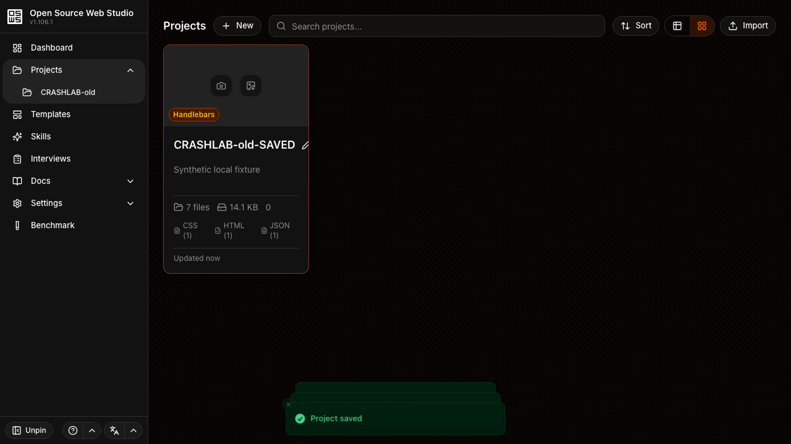
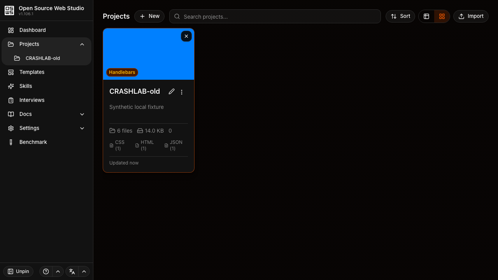

# An earlier tab's thumbnail can rewind saved project metadata

**Copy one native Playwright file into OSW Studio.** It changes a project
thumbnail through the real UI, then protects the complete saved project row,
files, file tree and checkpoints. There is no App Crash Lab runner or JSON
contract to install.

On unchanged [OSW Studio v1.106.1, `b4a7a592`](https://github.com/o-stahl/osw-studio/tree/b4a7a592c7e09cf97d9ee348a23105c10a9857a9),
the same-tab and fresh-peer controls **PASS**. The earlier-peer test **FAILS**:
only uploading a thumbnail returns the saved project name and
`lastSavedCheckpointId` / `lastSavedAt` to earlier values, persisting after reload.
**The saved file itself remains present.** These are our local operator results;
the maintainer has not confirmed running this test.

## Copy and run

Use a disposable checkout of the pinned public app with **Node 22+** and no
private environment files or browser profile. Its lock already provides
`@playwright/test` 1.62.1; no new test dependency is needed.

1. Review and copy [`stale-thumbnail.spec.mjs`](stale-thumbnail.spec.mjs) and
   [`playwright.config.mjs`](playwright.config.mjs) into an unused
   `e2e/crashlab-osw/` folder in the app. Keep existing files if that path exists.
   The [small ZIP](https://aichance.github.io/business-ai-recipes/app-crash-lab-osw-native-v0.1.0.zip)
   and [checksum](https://aichance.github.io/business-ai-recipes/app-crash-lab-osw-native-v0.1.0.zip.sha256)
   contain the same files, guide, license, screenshots and results.
2. From the app root, prepare its locked dependencies and the two assets normally
   copied by its root postinstall. Dependency lifecycle scripts stay disabled:

```sh
npm ci --ignore-scripts --no-audit --no-fund
node --input-type=module <<'JS'
import {copyFileSync, mkdirSync} from 'node:fs';
mkdirSync('public/preview-capture', {recursive: true});
copyFileSync('node_modules/esbuild-wasm/esbuild.wasm', 'public/esbuild.wasm');
copyFileSync('node_modules/modern-screenshot/dist/index.js', 'public/preview-capture/modern-screenshot.js');
JS
npx --no-install playwright install chromium
export NEXT_TELEMETRY_DISABLED=1 NEXT_PUBLIC_TELEMETRY_ENABLED=false
export NEXT_PUBLIC_SERVER_MODE=false NEXT_PUBLIC_DESKTOP=false NEXT_PUBLIC_LOG_LEVEL=error
export DATA_DIR="$PWD/.crashlab-osw-data"
npm run build
npm run start -- --hostname 127.0.0.1 --port 57958
```

Keep the port and data-directory path unused. The measured build used those
Browser Mode flags and an isolated empty data directory, without credentials,
provider requests or a server database. The ignored native SQLite install can
log scheduler initialization errors; this test does not exercise that scheduler.

3. In a second terminal at the app root:

```sh
APP_URL=http://127.0.0.1:57958 npx --no-install playwright test --config=e2e/crashlab-osw/playwright.config.mjs
```

Expected on the pinned source: **2 passing controls, 1 failing regression,
exit 1**. No test is skipped or marked as an expected failure. To run only the
controls, append `--grep 'same tab|fresh peer'`; exit 0 is expected. With an
existing Playwright config, copy only the spec and set its `baseURL` to the same
loopback HTTP origin. Keep the empty storage state and all three cases.

## What the three cases establish

The primary tab uploads `crashlab-proof.txt`, manually saves it, and renames the
project. The test confirms the real file content and saved checkpoint exist.
The thumbnail is then uploaded in that tab, a peer opened after the save, or
a peer hydrated before the save. Its actual persisted image and UI image source
must agree before preservation is checked.

| Thumbnail operation | Saved name / checkpoint after reload | Complete files / file tree / checkpoints | Result |
| --- | --- | --- | --- |
| Same tab | Preserved | Unchanged | PASS |
| Fresh peer | Preserved | Unchanged | PASS |
| Earlier peer | Rewound to earlier values | Unchanged; saved text file remains | FAIL |

The complete project comparison excludes only the intended `previewImage`,
`previewUpdatedAt` and `updatedAt`. Reads use one real readonly IndexedDB
transaction across four stores; the observer never creates a missing database
or supplies write values. Real transaction completion is observed, not forced.
Reload state is read before opening the workspace could create a fresh checkpoint.
Soft preservation assertions still fail the test and report every mismatched
field. A `PRECONDITION` failure means setup/commit was not established and is
not evidence of this metadata rollback.

Before thumbnail upload in the primary tab:



After only uploading a blue thumbnail in the earlier peer:



The earlier card's displayed file count is stale too; the actual records remain.
Screenshots illustrate the UI. The complete stored snapshots, not the card count,
establish preservation. Each run writes `observation.json`, `snapshots.json` and
screenshots to Playwright's output directory; failures retain a browser trace.

## Scope and reuse

This is an IndexedDB adaptation of the [earlier-tab preservation test](../livepage-native/README.md).
For another app, replace its readiness, UI workflow, database/store layout and
protected fields with the real ones. Keep both controls, a durable changed
baseline, the proven thumbnail commit and complete stored-record comparisons.

All **1,473 extracted original app files stayed unchanged**; the public
`.env.example` was omitted. We used a production build on macOS arm64,
Node 22.16.0, Next 16.3.0, Playwright 1.62.1 and matching headless Chromium.
[RESULTS.json](RESULTS.json) binds the exact spec hash to all three outcomes.
The sandboxed preview raises service-worker SecurityErrors in both passing
controls and the regression; no sandbox restriction was weakened.

An additional operator probe reopened the workspace and used Discard Changes
after a later unsaved upload. The saved file remained and the unsaved file was
removed in all three cases. Reopening created fresh checkpoint IDs, so this
does **not** demonstrate a destructive restore to the earlier pointer. We make
no file-loss, server/desktop, cross-browser, simultaneous-write or upstream-fix claim.

The original test and guide are MIT licensed; upstream source is not bundled.
Use synthetic local data and review traces before sharing them.
[Report an own-app run or first setup blocker](https://github.com/aichance/business-ai-recipes/issues/new?title=Native%20OSW%20Playwright%20check%20result).
Include app/version, environment, adaptations and actual outcome.
