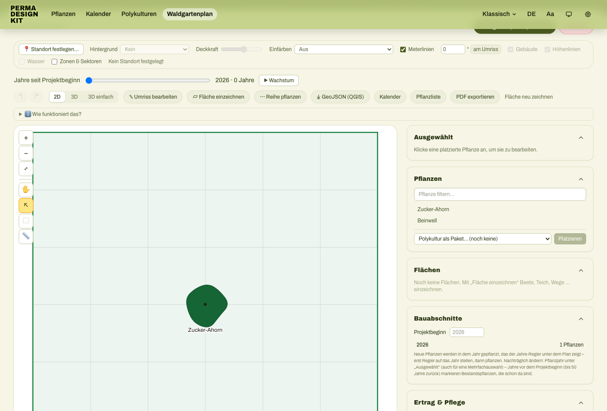
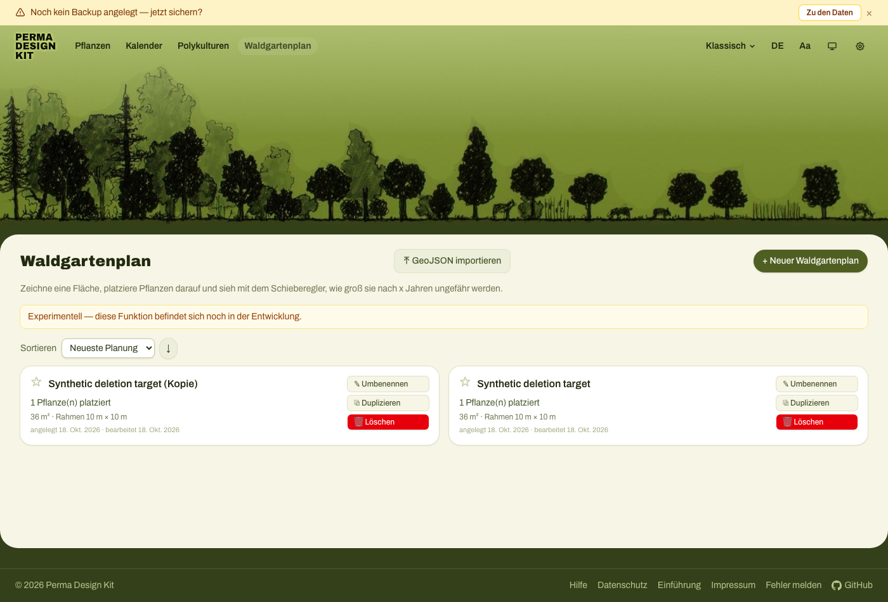

# A pending autosave can bring a deleted garden plan back

**Copy one file into Perma Design Kit's existing Playwright suite.** This
regression uses its real plant-drag and delete controls, observes IndexedDB
read-only, and includes the normal controls. It needs no App Crash Lab runner.

On unchanged [public source `426ebb6`](https://github.com/tbdal/Perma-Design-Kit/tree/426ebb69790218cf930b41273aabe5201d62f98f),
**3 tests PASS and 3 FAIL**. Two failures reproduce the deleted-record
resurrection described by a collaborator in [issue 7](https://github.com/tbdal/Perma-Design-Kit/issues/7).
The third checks a separate orphaned view-setting key. These are our local
operator results; author execution of this file is unconfirmed.

## Copy one file and run

Use a disposable checkout of that public source, with Node 22.12+ and the app's
existing dependencies. From its `pwa/` directory:

1. Copy [`delayed-delete.e2e.ts`](delayed-delete.e2e.ts) into
   `e2e/delayed-delete.e2e.ts`. If that path already exists, keep it and use
   another unused `*.e2e.ts` name, then adjust the command below.
2. Build the unchanged app and run the new file:

```sh
npm run build
npm run e2e -- e2e/delayed-delete.e2e.ts --workers=1
```

For a fresh local checkout, first run `npm ci --ignore-scripts --no-audit --no-fund`
and `npx --no-install playwright install chromium`. The original Playwright
configuration starts `scripts/serve-dist.mjs` on **127.0.0.1:4399**. Keep that
port free. No proxy, account service, deployment script or private expert module
is needed for these public-build checks.

On the measured pin the test command exits **1**, with the six outcomes below.
No test is skipped or marked `test.fail()`. A `PRECONDITION` error means the
baseline, actual drag, actual deletion or timing window was not established;
it is not evidence of resurrection. Run all six cases to retain the controls.

## Measured outcomes

| Action after a real plant drag | Stored target after reload | Result |
| --- | --- | --- |
| Wait for the moved plant to save; delete in the editor | Absent; all retained records unchanged | PASS |
| Delete in the editor before the 500ms autosave | Initially absent, then restored and still present after reload | FAIL `DELETED_RECORD_REAPPEARED`; measured deletion upper bound 85.3ms |
| Wait for the moved plant to save; return to the list and delete | Absent; all retained records unchanged | PASS |
| Return to the list and delete before the autosave | Initially absent, then restored and still present after reload | FAIL `DELETED_RECORD_REAPPEARED`; measured upper bound 122.2ms |
| Settled editor deletion: also require removal of its saved view key | Target record stays absent, but its view key remains | FAIL `ORPHAN_VIEW_KEY` |
| Settled list deletion: require the same view cleanup | Target and view key stay absent | PASS |

The elapsed values are conservative upper bounds measured from just before
the actual pointer-up to the first confirmed committed absence. Slow runs
that miss the 500ms window fail the precondition instead of quietly becoming
passing normal-deletion controls. Those two timings are not universal limits.

### Actual screenshots from the pending-editor case

A real UI-created plan with a placed sample tree, before the drag/delete:



After the target was observed absent, the observation window elapsed and the
page reloaded, the target appeared again next to the retained copy:



The screenshots show the viewport. The IndexedDB checkpoints separately prove
the target ID was absent before it reappeared; the second card alone is not
used as evidence of a completed deletion.

## Assertions to keep when adapting this test

- The plant and plans come from UI actions: load the app's two sample plants,
  draw a boundary, place a plant, save and duplicate the plan. A real reload
  establishes the saved baseline. The duplicate is a complete retained record,
  not just a count to compare.
- One completed **read-only transaction** reads all four stores. Missing
  databases/stores or failed reads do not become empty arrays. All complete
  retained records stay protected; only the intentionally deleted plan ID is
  removed from that comparison.
- Confirm that the plant actually moved and the deletion actually committed.
  Then keep the deleted ID absent across the 1200ms observation window and
  reload. Samples are about 40ms apart; unobserved instants and later writes
  are outside the measurement. Every observed resurrection is latched.
- Check view cleanup separately, after the handler visibly completes. A
  later reload that cleans an orphan must not hide the earlier observation.
- Use a fresh empty browser context, loopback HTTP, blocked service workers
  and external requests, and exact expected dialog handling. The only
  initialized localStorage values suppress the upstream test setup's welcome
  and persistence banners; they do not seed plant or garden data.

This is a related stale-write boundary to the [earlier-browser-tab example](../livepage-native/README.md):
the deleted state must survive a write scheduled from an older in-memory value.
Here the trigger is a pending same-page autosave, not an earlier browser tab.

## Scope and source provenance

Measured on October 18, 2026, with macOS arm64, Node 24.19.0, Playwright 1.63.0
and its default Chromium browser, one worker, using the original upstream
configuration and production build. All **267 upstream files stayed unchanged**;
only this test was added. Targeted TypeScript checking also passed.
[`RESULTS.json`](RESULTS.json) records the exact spec hash and six outcomes;
each run attaches the complete `deletion-checkpoints` JSON.

The public build displayed **Klassisch** mode. We did not test the installed
iOS PWA, WebKit, private Team/expert build, bfcache recovery or the separate
backup-import hang. This is neither certification of the whole issue nor a
confirmed upstream fix.

This original test and guide are MIT licensed. The upstream application has
its own [FSL-1.1-MIT license](https://github.com/tbdal/Perma-Design-Kit/blob/426ebb69790218cf930b41273aabe5201d62f98f/LICENSE.md);
its source is not bundled here. Screenshots use local synthetic test data.

[Report an own-app run or first setup blocker](https://github.com/aichance/business-ai-recipes/issues/new?title=Native%20Playwright%20deletion%20check%20result).
Include the app/version, environment, adaptations and actual outcome. Remove
private data before sharing traces. Keeping or starring the repository is optional.
