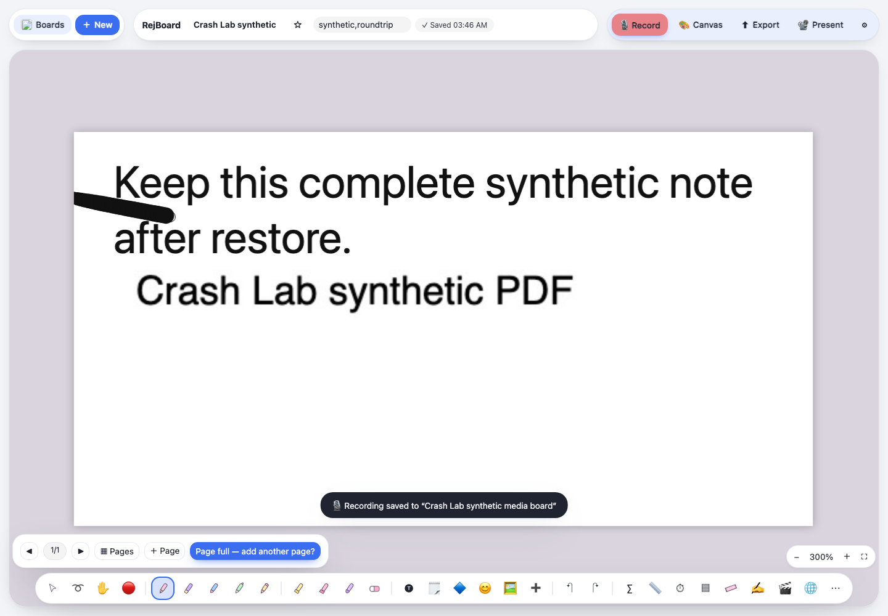

# RejBoard: test the contents of a real backup

A runnable baseline for [RejBoard's backup/restore testing request](https://github.com/RejwanShafi25/RejBoard/issues/2), measured against original commit [`14d6318`](https://github.com/RejwanShafi25/RejBoard/tree/14d63180e4cb932db39793050992ff406f8a3165). It checks a complete board containing handwriting, text, tags and a rasterized PDF page, plus a synthetic recording's metadata and **all 3,567 audio bytes**.

**Measured result:** the board and audio bytes survived. Import changed the recording Blob's type from `audio/webm;codecs=opus` to `audio/webm`. The pack reports that difference explicitly; it does not label all original data and types preserved, or claim missing/unplayable audio.

[Download the trial ZIP](https://github.com/aichance/business-ai-recipes/raw/refs/heads/main/docs/app-crash-lab-rejboard-trial-v0.1.0.zip) · [SHA-256](https://github.com/aichance/business-ai-recipes/blob/main/docs/app-crash-lab-rejboard-trial-v0.1.0.zip.sha256) · [measured results](RESULTS.json) · [source and fixture provenance](SOURCE.json)

**Want a test for the existing single-board `.rjwb` Save a copy/Open path?** Copy [this standalone Playwright test and its fixture](NATIVE.md) into an existing suite. It checks the actual downloaded file, recording bytes, reload and deliberate text/audio controls without importing App Crash Lab. It is separate from the all-board JSON trial ZIP below.



## Run

Use Node.js **22+**, Python 3 and a disposable RejBoard checkout at the commit above. The app's original `index.html` is not included in this pack. The tool is App Crash Lab **0.12.0-dev.2**, a pinned prerelease.

In Terminal A, inside that RejBoard checkout:

```sh
python3 -m http.server 59819 --bind 127.0.0.1
```

Extract the trial ZIP. In Terminal B, inside its `rejboard-trial` folder:

```sh
npm ci --ignore-scripts --no-audit --no-fund
npx playwright install chromium
npm test -- --out .crash-lab/rejboard-1
```

The trial verifies the served `index.html` hash, opens fresh isolated Chromium contexts, uses synthetic records through the normal Restore input and confines requests to the loopback app. It needs no app account, model or API key. The first install downloads the pinned tool and Playwright. Browser system dependencies may be needed on a fresh Linux machine.

Use a new output name for each run. An existing output directory is refused. Another loopback port can be passed with `--base-url http://127.0.0.1:PORT`. For a later version, inspect its source and adapt the contracts first; `--source-sha256 HASH` explicitly selects the hash you inspected. Selecting a new hash does not establish compatibility.

## What the result means

| Check | Measured outcome |
| --- | --- |
| Complete `n` store after reload | PASS |
| `{}` rejected without changing the saved board | PASS |
| Actual JSON export → empty browser context → restore → reload | PASS for every selected board field, including text, ink coordinates, PDF raster data, layers, IDs and timestamps |
| Deliberately changed text with the same board/item counts | FAIL, at the changed `text` and `html` fields |
| Original recording backup → real Restore | Metadata and all audio bytes match; **Blob MIME parameters differ** |
| Re-export of that restored state → another empty context → restore → reload | Complete boards, recording metadata, bytes and current Blob type match |
| One altered audio byte, same length and metadata | Detected |

`summary.json` records each result. **Exit 0 means this measured baseline and the intentional controls were reproduced.** It includes `allOriginalDataAndTypesPreserved: false` for the MIME difference. Exit 1 means a check or setup failed; inspect `error` and the individual reports rather than treating it as proof of data loss.

App Crash Lab's current JSON observer cannot read IndexedDB Blob values. Its contracts cover the complete JSON `n` store. `media-audit.mjs` is a complementary Playwright check that reads native Blobs, compares their full bytes and metadata, and separately reports their type. The actual media import/export/reload and one-byte control execute against the original app; no storage implementation is substituted.

The output folders include HTML reports, JSON state differences and generated standalone `repro.spec.mjs` files. To run the generated board-backup reproduction after the trial:

```sh
npx playwright test --config .crash-lab/rejboard-1/roundtrip/playwright.config.mjs
```

For the regular CLI instead of the combined trial:

```sh
npx app-crash-lab run roundtrip.json --out .crash-lab/rejboard-cli-1
```

The standalone generated test requires Playwright but does not import App Crash Lab.

## Fixture and limits

The fixture was originally created through RejBoard's real PDF import dialog, text editor, pointer drawing, tag input and MediaRecorder using Chromium's **fake audio device**. No person's microphone was used. Repeated runs import that disclosed fixture; they do not repeat PDF decoding or recording capture. The app stores the imported PDF page as a JPEG raster; this does not test original PDF-file byte retention. Audio decoding, playback quality and visual equivalence are outside the assertions.

This combined trial tests the existing all-board JSON format. The separate [standalone file test](NATIVE.md) covers existing single-board Save/Open. Multi-board export, replace/keep-both/skip, synced folders, file locks, desktop IPC, browsers other than the measured Chromium, private backups and every RejBoard feature remain outside coverage. Source-only browser results do not prove desktop or cloud-sync behavior.

Prepared and exercised by aichance using AI under a human owner's responsibility. These are operator results; independent author use is not claimed. The MIT license applies to this original pack and synthetic artifacts. RejBoard and the PDF renderer retain their own licenses; their source is not redistributed here.

[App Crash Lab source and reusable contracts](https://github.com/aichance/business-ai-recipes/tree/main/tools/app-crash-lab)
