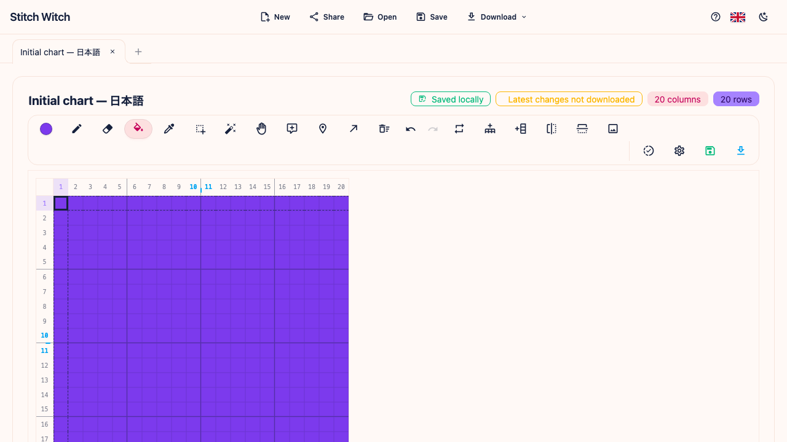
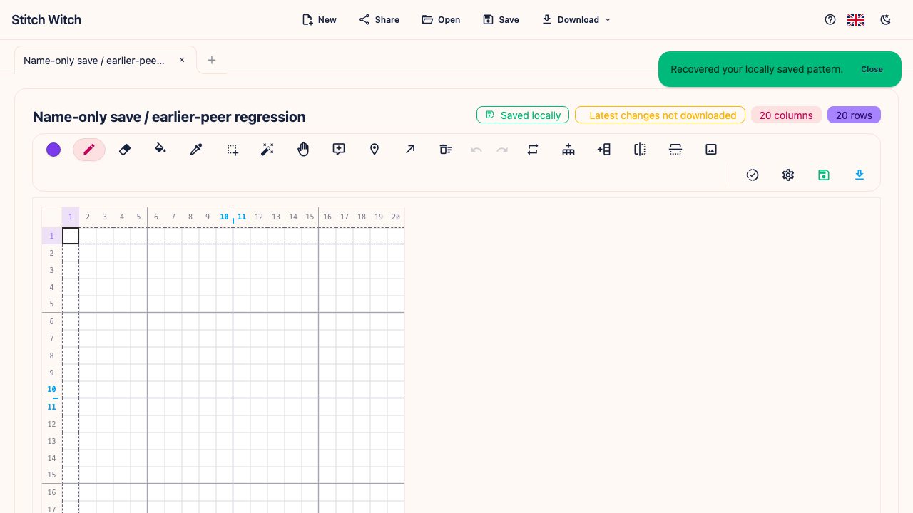

# A rename in another browser tab can roll back a saved chart

**Copy one test file into StitchWitch's existing Playwright suite.** This is an
app-specific version of the [LivePage stale-tab check](../livepage-native/README.md),
using StitchWitch's actual UI and dynamically discovered project ID. It uses
your existing Playwright setup and has no App Crash Lab runtime dependency.

Measured on unchanged [StitchWitch source `f31655c3`](https://github.com/carinaruut/stitchwitch/tree/f31655c3c73c29dda62049888a116b30e995647e)
on October 18, 2026: **2 controls PASS, 2 regressions FAIL**. These are our local
results, not a report that the author ran the test.

## Copy one file and run

In a disposable checkout of the pinned StitchWitch source, with its existing
dependencies and Chromium installed:

1. Copy [`stale-browser-tab.spec.mjs`](stale-browser-tab.spec.mjs) into
   `tests/e2e/stale-browser-tab.spec.mjs`. Keep any existing file of that name.
2. Run from the app's root:

```sh
pnpm exec playwright test tests/e2e/stale-browser-tab.spec.mjs --project=chromium --workers=1
```

The app's original `playwright.config.ts` starts its local Vite server on port
4173. Use a free port and a disposable checkout with synthetic data. To run
against another already running local build, set `STITCHWITCH_URL` to that
HTTP loopback origin. The original Playwright webServer configuration still
applies; review it before changing ports.

On the measured pin, the command exits **1**: two tests pass and two fail with
the assertions below. This is the expected result for the measured faulty
version. Nothing is marked `test.fail()` or skipped to make a broken app green.
A `PRECONDITION` failure means setup or the actual save was not established;
it is not proof of either rollback.

## What the test found

| Case | What it protects | Measured result |
| --- | --- | --- |
| Same browser tab | Complete saved project except the intentionally edited name | PASS |
| Peer opens after the new chart is saved | Same non-name fields, including the full chart | PASS; this does **not** establish that the later name survives reload |
| Peer opens before the new chart is saved, then only renames it | Same non-name fields; remember any observed loss even if later repaired | FAIL `PRESERVATION`: 400 purple cells become 400 white cells in shared storage |
| Fresh peer renames; original tab reloads | Non-name fields **and** the committed peer name after reload | FAIL `RELOAD_RENAME`: the newly saved name becomes the previous name |

Both pages load the same app-managed project ID. The earlier peer finishes its
own startup autosave before the primary page edits anything, so the measured
rollback is not a startup race. The primary fills the actual grid through the
documented Fill shortcut, then waits for the saved record and `Saved locally`.
The peer changes only `Project name` and blurs the field; the test confirms that
the new name actually reached the saved document.

The protected comparison covers the **complete saved envelope except
`pattern.name`**, rather than just a count or one cell. In the earlier-peer
case, `cells`, `palette` and `recentColors` reverted. The original page's reload
later restored the purple chart but also reverted the peer's committed name.
That repair does not erase the earlier recorded loss. The fourth test checks
the separate name loss, which the two non-name controls do not cover.

### Actual screenshots from the failing earlier-peer test

Primary page after its grid edit was saved:



Earlier peer after its name-only save:



These are different browser pages, and each image shows only the viewport.
The peer's stale white rendering alone would not prove data loss. Separate
read-only snapshots of the shared saved record confirm all 400 cells changed
from purple to white after the name commit.

## Evidence and limits

[`RESULTS.json`](RESULTS.json) records the source pin, exact spec hash,
four results, saved-state summaries and screenshot hashes. Each run attaches
the complete `saved-document-checkpoints` JSON; the upstream configuration also
keeps failure traces. Treat traces from your own app as potentially private.

- Measured using the original upstream configuration on macOS arm64, Node
  24.19.0, pnpm 11.17.0, Playwright 1.62.1 and its Chromium project, one worker.
  All 168 upstream files stayed unchanged; only this test file was added.
- Each case uses a fresh isolated context. Requests and WebSockets are limited
  to the local app origin, and service workers are blocked. Storage is read for
  observation, not seeded or patched. Only the expected reload's
  `beforeunload` is accepted; other dialogs fail the precondition.
- The 1000 ms observation windows exceed this app's 300 ms debounce. Samples
  are about 75 ms apart; unobserved instants and later writes are not covered.
- This checks one ordered two-page save scenario. It does not certify the full
  first-glove/second-glove journey in [issue 46](https://github.com/carinaruut/stitchwitch/issues/46),
  exports, Tracker, Firefox, WebKit, or the entire upstream test suite.

For another local-first editor, adapt the UI actions, project key lookup and
protected value to that app. Keep the passing controls and actual peer-commit
check. If a fix rejects stale writes instead, update the completion trigger to
match the intended conflict behavior while retaining the preservation check.

[Report an own-app result or setup blocker](https://github.com/aichance/business-ai-recipes/issues/new?title=Native%20Playwright%20save%20check%20result).
The useful result is the app/version, unchanged test or adaptations, environment
and observed outcome. Keeping or starring the repository is optional.
