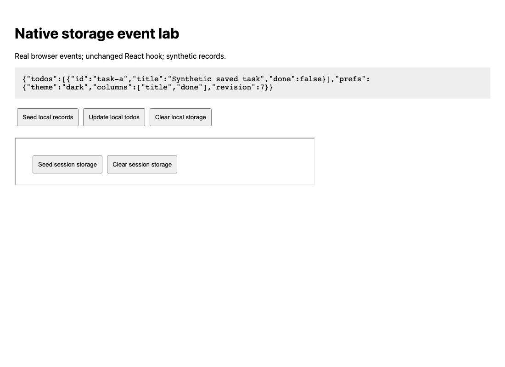
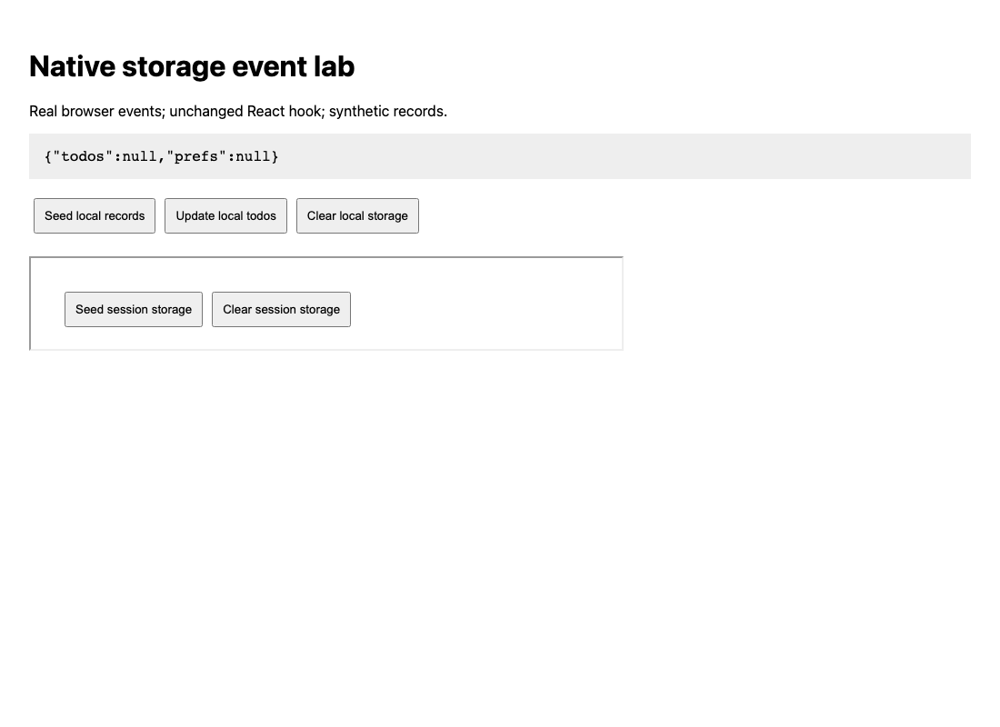

# Real two-tab `localStorage.clear()` regression

An unchanged React hook can receive a real browser `storage` event with `key: null`, yet leave two mounted values stale. This small Playwright check compares the original source with the existing upstream fix. It complements the fix author's jsdom tests with browser-generated events; it does not replace them.

| Source | Peer `setItem` | Iframe session clear | Peer local clear |
| --- | --- | --- | --- |
| Base [`799291ab`](https://github.com/astoilkov/use-local-storage-state/tree/799291ab6152fbdca80823bf6b12e87257d98638) | PASS | PASS | FAIL: both displayed values remain stale |
| PR86 [`f53a57a5`](https://github.com/astoilkov/use-local-storage-state/pull/86/commits/f53a57a5e069262713e3ab6ae096e4c679ebc327) | PASS | PASS | PASS: both mounted values become empty before reload |

The fix and its original unit tests are **feritcemkahraman's [PR86](https://github.com/astoilkov/use-local-storage-state/pull/86)**. That PR was open when measured. Our added files are the native Playwright check, consumer fixture and measurements. These are AI-assisted operator results, not a report that the maintainer ran our test.

## What actually happens

1. Two real pages share one fresh browser context and loopback origin.
2. A peer's normal UI saves a complete todo record and nested preferences. Both hook values synchronize through real, trusted browser notifications.
3. A subsequent peer `setItem` updates its complete record while preserving the other key: normal control.
4. A same-top-level iframe performs a real `sessionStorage.clear()`. Its trusted null-key session event reaches the reader; local records and displayed values remain intact: isolation control.
5. A separate tab performs `localStorage.clear()`. The reader receives `isTrusted: true`, `key: null`, `oldValue: null`, `newValue: null`, with `storageArea` equal to its `localStorage`. Both actual stored keys are already absent. We require the mounted hook values to reflect that clear within the declared two-second assertion window.

On the base, the hook still displays the two old records. Reload fixes the display, but the test retains and throws the earlier consistency assertion. On the PR head, it updates before reload. There is no manual `dispatchEvent`, patched hook, mocked Storage implementation or simulated `isTrusted` flag.

**This is a stale-display bug after an intentional clear, not accidental deletion of the saved records.** The session control proves value retention; it does not instrument or prove the absence of an internal callback.

After the real clear, before any reload, the base still displays the synthetic records:



The unchanged PR head displays empty values at the same checkpoint:



## Run in an isolated test folder

Use Node22+ for this pack. Download this folder's files, or copy them out of a repository checkout. The upstream hook itself accepts Node14+; the pack's runtime requirement is separate. No upstream install/build script, app account, API key or App Crash Lab runner is used.

```sh
npm ci --ignore-scripts --no-audit --no-fund
npx playwright install chromium

mkdir upstream-base upstream-pr
curl -fL https://codeload.github.com/astoilkov/use-local-storage-state/tar.gz/799291ab6152fbdca80823bf6b12e87257d98638 -o base.tar.gz
curl -fL https://codeload.github.com/astoilkov/use-local-storage-state/tar.gz/f53a57a5e069262713e3ab6ae096e4c679ebc327 -o pr.tar.gz
tar -xzf base.tar.gz --strip-components=1 -C upstream-base
tar -xzf pr.tar.gz --strip-components=1 -C upstream-pr

STORAGE_CLEAR_SOURCE_DIR=./upstream-base npm test
# Expected exit1: two controls pass, the healthy clear assertion fails.

STORAGE_CLEAR_SOURCE_DIR=./upstream-pr npm test
# Expected exit0: all three cases pass using the same assertions.
```

Run the two test commands separately if your shell stops on the first nonzero exit. In PowerShell set `$env:STORAGE_CLEAR_SOURCE_DIR` before `npm test`; that platform was not measured here.

The spec checks the exact hook Git-blob hash, bundles that unmodified file with the pack's React, and starts/closes its own ephemeral local server. The install pins Playwright1.64.0, React/ReactDOM18.3.1 and esbuild0.25.11; lifecycle scripts are disabled. The verified source archives each contain17 regular Git blobs, unchanged after measurement. The spec itself checks only the hook hash; the complete archive audit belongs to this published measurement.

## Keep the check in an existing suite

Copy `storage-clear.spec.mjs` and `consumer.mjs` together into a Playwright test directory with React18+, ReactDOM and esbuild available. The measured combination is React18.3.1; other versions are not established by this result. An isolated copy of the included package/lock avoids changing your application's dependencies.

When adapting to another hook, replace the explicit reviewed source hash and actual imported hook, keys, consumer actions and full expected records. Keep the native-event preconditions and normal/isolation controls. An unknown hash or failed mount is a setup failure, not confirmation of the bug. Do not switch the healthy assertion to `test.fail()` merely to make the base run green.

## Exact measurement and limits

Both variants ran once on2026-10-20 with one worker, no retries and no skips. Base runner duration5.734s; PR head3.673s. The clear case took2.478s and0.449s respectively. Complete checkpoints, native event fields and source/code hashes are in [RESULTS.json](RESULTS.json). Dependency audit reported0 known vulnerabilities at measurement time; this is time-bounded, not a security guarantee.

This covers local Chromium, one host, two keys with no `defaultValue`, and an actual React consumer. It is not a cross-browser, SSR, storage-quota, fallback-memory, every serializer/default-value combination or full upstream Vitest-suite result. The original source and fix remain attributed to their authors. The pack's test and fixture are MIT under this repository's [license](../../../../LICENSE).
