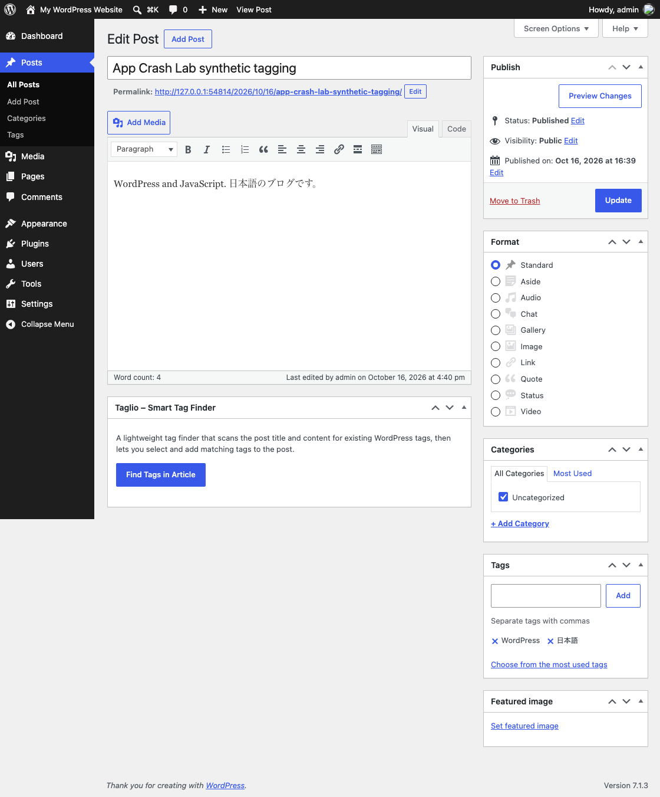

# Taglio: selected tags survive WordPress save and reload

Taglio finds existing WordPress tags in a post, but adding candidates to the
editor is not the same operation as saving the post. This example checks both
the editor's saved tags and the post's actual REST `tags` IDs after **Update →
reload**. It uses Taglio1.0.1's original four files, WordPress7.1.3, PHP8.3 and
a fresh SQLite-based WordPress Playground fixture. No real WordPress site is
used, and no plugin code is patched.

The synthetic post contains `WordPress`, `JavaScript` and `日本語`. The test
selects only WordPress and 日本語; the saved IDs must remain `[2,4]`, with two
visible tags and no JavaScript tag. The initial UI inspection also confirmed
that the registered `press` and `unused` tags were not offered as matches.

| Check | Result |
| --- | --- |
| Find → select two tags → Add Selected Tags → Update → reload | PASS |
| Deliberately remove 日本語 and save after reload | FAIL; missing ID4, tag count2→1, Japanese tag1→0 |
| Generated, unchanged standalone Playwright test | PASS in a separate run |

The failing row is an **authored input control**, not a reported Taglio defect.
These are operator measurements, separate from author adoption or production
certification. See [measured values](results-summary.json) and [source](SOURCE.json).
The published fixture measured 16.25s for the normal CLI check, 25.01s for the
deliberate control and 12.23s for the standalone rerun. These local wall times
include runner work and are not a performance benchmark.



## Start a fresh synthetic site

This fixture launcher is for POSIX macOS/Linux; Windows-native is rejected
before startup. The measured environment is macOS; Linux was not independently
tested here. You need Python3, **Node24.18+ and npm11.16+** for the pinned Playground
dependencies. App Crash Lab itself still requires Node22+. The fixture does
not install or upgrade your global Node/npm. First startup downloads the two
hash-checked official ZIPs and locked npm packages. It needs network access
and space for a disposable WordPress tree; it is not a hosted demo.

From an empty writable work folder, download the complete small setup pack:

```sh
curl --fail --location https://raw.githubusercontent.com/aichance/business-ai-recipes/main/docs/app-crash-lab-taglio-pack-v0.1.0.zip --output taglio-pack.zip
python3 -m zipfile -e taglio-pack.zip .
cd taglio
python3 start.py
```

If you already have this source checkout, run `python3 start.py` from this
directory instead. The server binds only `127.0.0.1:54814`. Open the printed
local editor URL to inspect the synthetic post. Playground automatically logs
into its disposable admin; no real credentials or existing browser profile
are used. A small fixture-only filter selects WordPress's classic editor.
**Gutenberg is not covered by this result.**

Wait for the exact **`Ready! WordPress is running on http://127.0.0.1:54814`**
line from Playground before opening the editor or running the check. The
earlier URL says where it will run and is not a readiness signal. If startup
exits with an error, stop there. Keep that terminal running. The output stays in a new
`tools/app-crash-lab/.crash-lab/taglio-*` directory in a source checkout, or
the extracted pack's parent `.crash-lab/taglio-*`. An explicit `--state NEW_PATH`
is also supported; existing paths are refused. Stop the fixture with Ctrl-C.
The files are retained for inspection; the tool does not delete other sites.

## Run the saved-state check

In another terminal, from the same `taglio` directory:

```sh
npx --yes --package=@playwright/test@1.64.0 playwright install chromium
npx --yes --package=https://github.com/aichance/business-ai-recipes/releases/download/app-crash-lab-v0.10.0/aichance-app-crash-lab-0.10.0.tgz app-crash-lab run tag-save.json
```

Open the absolute HTML report path printed by the runner. Its output includes
the observed before/after values, a trace and an unchanged standalone
`repro.spec.mjs` with a one-worker config. With `@playwright/test@1.64.0`
installed in that output directory, run `npx playwright test --config
playwright.config.mjs`. The generated test needs Playwright but does not
import App Crash Lab. It shares the CLI's protocol, so this is a separate
execution, not an independent testing algorithm.

To verify the contrast, replace `tag-save.json` with
`tag-save-known-control.json`; **exit1/FAIL is expected**. Run these sequentially,
not in parallel: each check resets the shared synthetic post100. The reset
endpoint only exists in this new fixture, requires its fixture marker and
fixed post ID, and is not a production endpoint or an authentication system.
Never copy it into an existing WordPress installation or point this contract
at real content. The published setup refuses an occupied port and clamps
Playground's server process to IPv4 loopback.

For a different free port, start with `python3 start.py --port 54815` and add
`--base-url http://127.0.0.1:54815` to each App Crash Lab command. Linux may
also need Playwright's browser system libraries; system package installation
is a separate local administrator action.

## Adapt it to another WordPress plugin

Keep the disposable-site approach. Replace the plugin source and hash only
after reviewing that official source, seed synthetic records, and inspect its
real save path. Change the setup actions and observed REST/DOM values together.
Keep an actual known-good baseline and a deliberate missing-state control.
Do not loosen expected values or patch plugin behavior to manufacture PASS.

The current measurement covers only the pinned free Taglio workflow with the
English UI and a Japanese/English synthetic post, in the classic editor. It
does not cover Gutenberg, MySQL, the premium features, concurrent editing,
other locales, production credentials, arbitrary plugins or backup restoration.
The one-worker Playground server is used for sequential checks; it emits a
warning about possible locking under other workloads. Source downloads retain
their upstream GPL licenses; this pack distributes our fixture/test files,
not WordPress or Taglio's application source.

日本語: 「候補を追加した」表示で止めず、WordPressの更新後・再読込後の
保存タグIDと画面のタグを比較します。正常系PASS、意図的に1件外す対照FAIL、
単独Playwright再実行PASSです。作者による実行報告や新しい不具合発見の主張
ではありません。自分のプラグインへ編集する場合も、実サイトではなく
合成投稿の専用環境で試してください。
