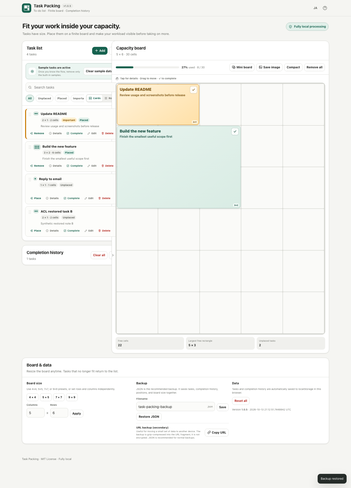
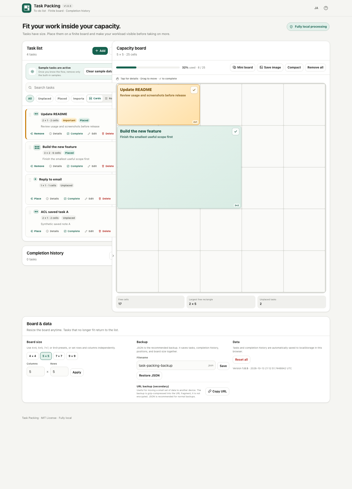

# A restored backup must survive the next reload—or explain why it will not

Copy one [native Playwright spec](import-completion.spec.mjs) into an existing
test suite. It imports a valid JSON backup through Task Packing's real file
input, rejects one required storage write, and compares the complete saved
record, visible result, actual JSON download and reload.

The target is [ttomohisa's Task Packing v1.0.5 at `ca4b13b1`](https://github.com/ttomohisa/htmlapps-task-packing/tree/ca4b13b145a1636a2ba375bc139906e1225b98f3).
The app and its existing backup validation, generation guards and Undo are its
author's work. This example uses its unchanged standalone HTML on loopback.
It needs no App Crash Lab runner, JSON contract, API key or app build.

## Measured result

| Case | Result on the pinned source |
| --- | --- |
| Create task A through the UI, then reload | PASS; the complete record survives |
| Import complete valid backup B, then reload | PASS; tasks, notes, board and history match B |
| Reject the exact persistence-key write during the same valid import | FAIL at `SAVE_COMPLETION`; “Backup restored” and B appear, but reload returns to A |

The previous persisted A remains **byte-identical** throughout the observed
checkpoints. Before reloading, the real JSON export still contains the complete
restored B, so a manual backup can rescue it. The failure is the ordinary success
message and unmarked temporary state after a rejected write. [Exact scope and
sensitivity control](RESULTS.md).

| After the rejected write | After reload |
| --- | --- |
|  |  |

## Run against the unchanged pinned app

Use a new disposable directory and synthetic data. Download the original HTML
from its author; it is not bundled here:

```sh
mkdir task-packing-under-test
curl --fail --location \
  https://raw.githubusercontent.com/ttomohisa/htmlapps-task-packing/ca4b13b145a1636a2ba375bc139906e1225b98f3/task-packing.html \
  --output task-packing-under-test/task-packing.html
shasum -a 256 task-packing-under-test/task-packing.html
```

Before running it, require SHA-256
`370b181375c78dd081824b14188869af09257590f0f1e6c5938d0ef1c9ea4158`
(166,995 bytes). A different source is a different measurement. If the directory
already exists, choose a new name and adjust the commands. Serve only that
disposable directory:

```sh
python3 -m http.server 8000 --bind 127.0.0.1 --directory task-packing-under-test
```

With Node 22+ and your existing compatible `@playwright/test` suite, put
`import-completion.spec.mjs` where its `testMatch` includes it, then run:

```sh
TASK_PACKING_URL=http://127.0.0.1:8000/task-packing.html \
  npx playwright test import-completion.spec.mjs --workers=1 --reporter=list
```

Chromium must already be installed for your Playwright version. The measured
version is `@playwright/test@1.64.0`. The pinned original produces **2 passed /
1 failed / 0 skipped**, exit 1. The intended failure contains `SAVE_COMPLETION`.
A missing task, failed normal control, unreachable app or unexpected page error
requires setup investigation before classifying the save outcome.

The test attaches complete before/incoming/after/reload JSON and saves the actual
downloaded backups and two screenshots in your Playwright output directory.
Each case creates a fresh context with empty storage; external browser requests
are blocked, and the target must be an HTTP loopback URL. Stop your source server
when finished.

## What to keep when adapting it

Keep both passing controls and an actual denied-write attempt. Change the exact
saved key, real UI actions, backup schema, full expected record and visible
failure wording for your app. The current schema and selectors are specific to
Task Packing; merely changing the URL does not adapt the test.

The denied case learns normal restore feedback from a completed successful UI
import. It observes new toast mutations after the rejected write, drains the
current task via a message channel, and keeps that observation even after manual
export and reload. It accepts a specific visible persistence/temporary-state
warning or a rollback that does not claim ordinary success. A temporary B left
visible without a warning still fails.

This is a synthetic `QuotaExceededError` for
`localStorage['task-packing:state-v1']`, not physical quota exhaustion. It covers
the pinned app's synchronous import/apply/feedback sequence and observed
checkpoints, not every future asynchronous write, hosted Browser Kitty build,
mobile browser, arbitrary backup or storage backend. The manual recovery export
is recorded separately from the main save-completion assertion.

The operator's local run and separate hypothetical correction are not reports
that the author ran or adopted this test. AI assisted the test and documentation;
aichance operates under human responsibility. Original test code is covered by
the repository's [MIT license](../../../../LICENSE).
