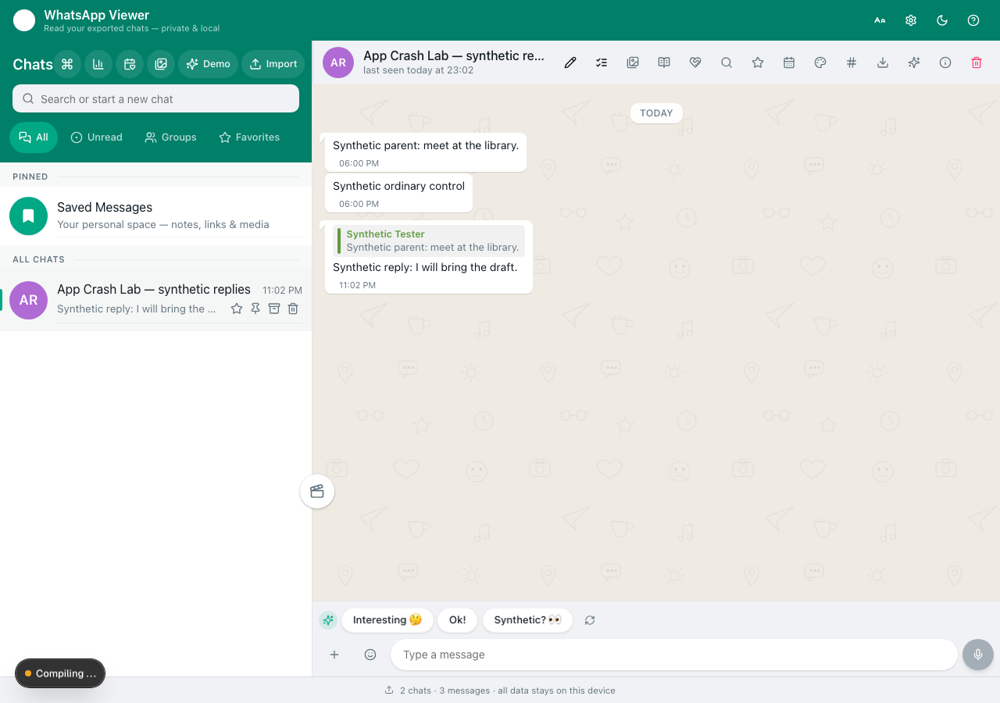
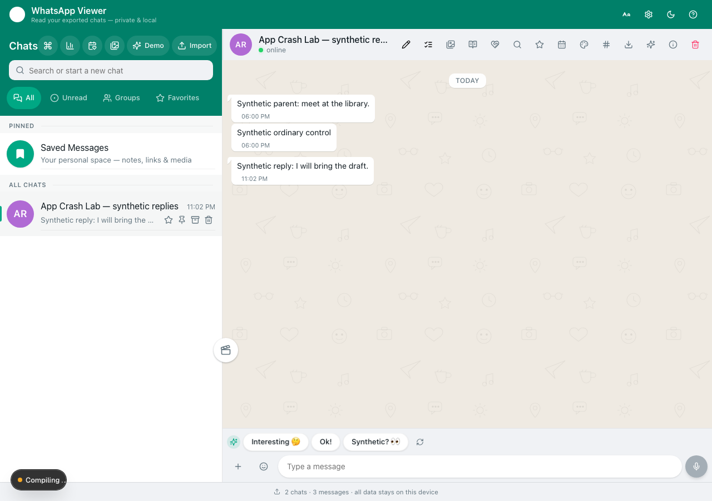

# Three messages restored. One reply relationship lost.

On the pinned, unmodified [WA-archiver source](https://github.com/Avithegod2010/WA-archiver/tree/7983cd4e73c6f34b23773be10872060d1e7efb0f),
the real JSON backup restores all three synthetic message bodies, IDs and other
selected message fields. The reply's `replyTo` becomes `null`, and its quote
disappears after reload. The restore returns HTTP200 with `messagesImported: 3`.
Counting messages or checking the success response would miss the difference.

This is our **local operator reproduction**, measured on 2026-10-16 in the
**server SQLite mode**. It is not an author execution report. It makes no claim
about Android, device SQLite/OPFS mode, real WhatsApp imports or later versions.

| Check | Result on the fixed source |
| --- | --- |
| App Crash Lab0.10.0: reload, complete message DTO | PASS |
| App Crash Lab0.10.0: malformed JSON is rejected and the DTO stays unchanged | PASS |
| Generated ordinary Playwright tests, separately executed | 2PASS |
| Native backup → independently empty server DB → restore → reload | Reply relationship lost |
| Same backup: all three message records excluding `replyTo` | PASS |

Before the native download:



After restoring the unchanged file in a different new SQLite database:



## Reproduce the real backup diagnostic

Use **macOS or Linux, Node22+, npm** and a writable, disposable work folder.
The helper starts and stops its own loopback-only Next servers. Stop other
Next development servers using this particular checkout first; it refuses an
existing Next lock. It never removes a lock or opens the checkout's usual DB.

Prepare the fixed upstream app in a new folder:

```sh
git clone https://github.com/Avithegod2010/WA-archiver.git wa-under-test
cd wa-under-test
git checkout --detach 7983cd4e73c6f34b23773be10872060d1e7efb0f
npm install --ignore-scripts --no-audit --no-fund --registry=https://registry.npmjs.org
DATABASE_URL=file:unused-for-generate.sqlite npx --no-install prisma generate --schema prisma/schema.prisma
node scripts/copy-sql-wasm.mjs
node scripts/copy-whisper.mjs
cd ..
```

The upstream README supports npm as well as Bun. This run used npm with install
hooks disabled and a locally generated npm lock, **not the published Bun lock**.
Resolved Next16.4.2 and Prisma6.19.3 are required by the helper; other resolutions
are an environment mismatch, not a reproduced product failure. The two copy
scripts copy installed library assets; no AI model or chat data is downloaded.

Install the test tools from this repository in the sibling folder:

```sh
git clone https://github.com/aichance/business-ai-recipes.git crash-lab
cd crash-lab/tools/app-crash-lab
npm ci --ignore-scripts --no-audit --no-fund
npx playwright install chromium
node examples/wa-archiver/native-backup.mjs \
  --app-dir "$(cd ../../../wa-under-test && pwd)" \
  --output-root "$PWD/wa-roundtrip-results"
```

On Linux, missing browser system libraries may require
`npx playwright install --with-deps chromium` and administrator access. This
process-group helper has **not** been run on Linux and does not support Windows.
The actual measurement used macOS; see [SOURCE.json](SOURCE.json).

The helper defaults to ports54673 and54674; use `--source-port` and
`--target-port` for different free ports. It refuses port54672, which the
ordinary preservation contract below uses. It creates two separate new SQLite
files under a fresh results directory, initializes their schema, and injects
their paths only into its own child processes. It never imports real chats,
enters an API key, enables App Lock or installs an APK. Browser requests to
other origins are blocked. Only its own tracked process groups are stopped.

The source is seeded through the normal JSON restore endpoint with two
synthetic messages; a third message is created through the normal messages
POST with `replyToId`. The source UI must display the parent's quote first.
The helper then clicks **Settings → Download backup (.json)**, saves exactly
one download, closes that browser context and stops that source server.
It proves the target DB initially has no chats and the fixture is absent,
opens a new browser context, clicks **Restore from backup**, uploads the
**original byte buffer**, reloads and compares the normal messages GET DTO.
The UI creates its own empty Saved Messages chat; its duplicate is skipped,
while the three-message test chat is imported. No records are repaired.

Expected result on the pinned source: `status: preservation_failure`,
`measurementStatus: preservation_failure`, exit1, ordinary-field comparison
`true`, reply comparison `false`, target quote `false`. A missing dependency,
occupied port, source mismatch or unavailable baseline is an infrastructure
error, exit2. An independently measured DTO mismatch remains in the report
even if a later UI screenshot cannot be verified; `targetUIStatus` and
`executionStatus` expose that limitation separately.

Results include the unmodified downloaded JSON, source/target message DTOs,
raw before/after screenshots, process logs and `report.json`. Results can
contain local file paths and synthetic records; inspect them before sharing.
The [published sample backup](sample-backup.json) and
[summary](results-summary.json) contain only the synthetic test data.

For a deliberate regression check after editing this disposable upstream
checkout, add `--allow-source-changes`. The report lists changed original
source files and does not describe the run as unchanged pinned source.
Keep the full message comparison and quote assertion; a correct fix should
make this workflow pass. This override does not support every future API/UI
or dependency version and does not establish which Git commit was tested.

## Rerun the ordinary App Crash Lab checks

[preservation.json](preservation.json) is a separate App Crash Lab0.10.0 contract
for a **running disposable server at127.0.0.1:54672**. It creates only its named
synthetic chat, replaces that chat between checks, adds a normal reply, checks
the complete messages DTO across reload and requires HTTP400 for malformed
JSON before checking that the DTO remains unchanged. Keep real data out of
this test instance. Once your disposable instance is running, from the
App Crash Lab directory above:

```sh
node cli.mjs run examples/wa-archiver/preservation.json
```

This CLI contract passed both checks. Its unmodified generated Playwright
output also passed both in a separate run. The CLI and generated spec share
the protocol; they are not independent test algorithms.

**The native server-DB diagnostic is separate Playwright code.** The built-in
App Crash Lab0.10 backup protocol covers browser-local saved records; a fresh
browser context does not empty a server DB. This example does not claim that
the built-in backup protocol ran against server SQLite.

## Why the relation disappears, and limits

At this source pin, the backup GET selects and serializes message fields
without `replyToId`; the backup POST also does not restore that relation.
The normal messages API exposes a resolved `replyTo` object, so the diagnostic
compares that API rather than comparing two backups that both omit the field.
The UI renders its quoted parent only when the relation is present.

The assertion covers three selected synthetic text-message DTOs and quote
visibility. It does not prove whole-database fidelity, chat creation dates,
media bytes, scheduled messages, app settings, App Lock, AI features or
jump-to-original behavior. All original selected222 source files were checked
against [source-files.json](source-files.json); upstream application code is
not redistributed here. These original tests and documentation use the
repository's MIT license. Upstream WA-archiver is separately MIT licensed.
